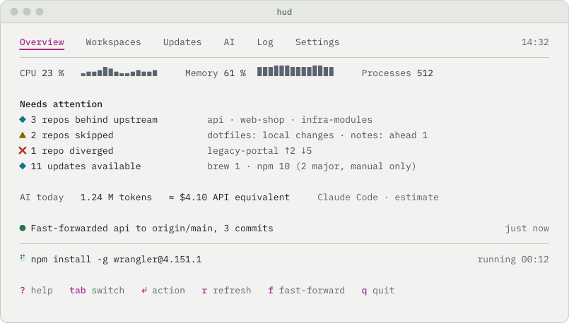

<div align="center">


# hud

**A heads-up display for your developer machine.**<br>
One terminal view for system load, Git workspaces, package updates and AI usage, which keeps clean repositories fast-forwarded on its own.

[](https://github.com/nimble-123/macos-hud/actions/workflows/ci.yml)
[](#install)
[](https://www.rust-lang.org)
[](https://ratatui.rs)
[](#data-and-privacy)
[](https://www.conventionalcommits.org/en/v1.0.0/)
[](LICENSE)

[Why hud](#why-hud) · [Features](#features) · [Safety](#safe-by-construction) · [Install](#install) · [First run](#first-run) · [Keys](#keys) · [Configuration](#configuration) · [Architecture](#architecture) · [Documentation](#documentation)

</div>

> [!NOTE]
> hud is in early development. Workspaces, the automatic fast-forward and the first-run setup work today; updates, the AI dashboard and the overview are next ([milestones](https://github.com/nimble-123/macos-hud/milestones)). The screenshot below is a design preview of the overview screen.

<div align="center">

<picture>
  <source media="(prefers-color-scheme: dark)" srcset="docs/assets/showcase-dark.svg">
  
</picture>

</div>

## Why hud

A typical machine carries dozens of repositories, three package managers and a couple of AI tools. Keeping them current means running the same commands in the same folders, and still missing the one repo that drifted. hud watches all of it and borrows a rule from aircraft cockpits:

- **Dark cockpit.** When everything is normal, nothing lights up. Colour appears only where something needs you.
- **Safe automation.** Clean repositories that are only behind are fast-forwarded automatically. Anything with local work is left alone, with the reason shown.
- **Opt-in, never by surprise.** Package updates are shown by default. Automatic installs are off until you turn them on per source, and major npm upgrades always wait for you.
- **Honest numbers.** Every value carries its source and accuracy. Costs are always marked as estimates.
- **Local-first.** No telemetry, no server, no account. hud only runs the tools you already have.

## Features

| | |
| --- | --- |
| **Overview** | CPU, memory and process totals with two-minute sparklines, plus a single list of what needs attention across repos, updates and AI usage. |
| **Workspaces** | Point hud at your project folders. It finds every Git repository and shows branch, upstream, local changes and ahead/behind counts. |
| **Auto fast-forward** | Every 15 minutes hud fetches quietly and fast-forwards repos that are clean and only behind. On by default, switchable off per workspace. |
| **Updates** | Outdated Homebrew formulae and casks, global npm packages and installed skills, each with the state of its CLI. Update one, or all, after a confirmation. |
| **Automatic installs** | Separate opt-ins for Homebrew formulae, casks and npm. Casks that ask for a password are flagged as manual and not retried. |
| **AI dashboard** | Claude Code sessions, models and tokens (input, output, cache write, cache read) for today, 7 days, 30 days, this month and last month. Codex as an optional source, including its plan usage. |
| **Log** | Every action, manual or automatic, with trigger, target, result and the tail of its output. |
| **Your terminal** | Light and dark detected from the terminal background, `NO_COLOR` respected, English and German, keyboard first with full mouse support. |

### Status at a glance

The colours follow the crew-alerting code of glass cockpits. Every state also has its own symbol and label, so nothing depends on colour alone.

| Symbol | State | Meaning in hud |
| :---: | --- | --- |
| ● | ok | just done: fast-forwarded, update installed |
| ◆ | advisory | repo behind upstream, update available |
| ▲ | caution | skipped: local changes, ahead, opted out, manual action needed |
| ✖ | warning | error, diverged history, CLI not found |
| ○ | normal | nothing to do |

With a [Nerd Font](https://www.nerdfonts.com) such as Hack Nerd Font, set `icons = "nerd"` for Git, Homebrew, npm and AI source icons. Plain `ascii` is there for minimal terminals.

## Safe by construction

hud fast-forwards a repository only when all of these hold:

1. no merge, rebase, cherry-pick, revert or bisect in progress
2. a branch is checked out and it has an upstream
3. no modified or staged tracked files (untracked files are fine; Git refuses to overwrite them)
4. the branch is behind its upstream and not ahead of it

The rule lives in a pure function in the domain layer. Passing it is the only way to obtain a `FastForwardPermit`, and `fast_forward` cannot be called without one. The permit pins both commit IDs, so if you commit in the meantime, hud notices and does nothing. Package installs work the same way with an `InstallPermit`.

## Install

With [Homebrew](https://brew.sh), from the [nimble-123/tap](https://github.com/nimble-123/homebrew-tap) tap:

```bash
brew install nimble-123/tap/hud
```

Update with `brew upgrade hud`; every release updates the formula automatically.

Or download `hud-<version>-universal-apple-darwin.tar.gz` (Apple Silicon and Intel) from the [latest release](https://github.com/nimble-123/macos-hud/releases/latest), unpack it and put `hud` on your `PATH`. The binary is not signed or notarized; if macOS blocks a browser download, run `xattr -d com.apple.quarantine hud`. To check that an archive was built by this repository's release workflow:

```bash
gh attestation verify hud-<version>-universal-apple-darwin.tar.gz --repo nimble-123/macos-hud
```

### From source

```bash
git clone https://github.com/nimble-123/macos-hud.git
cd macos-hud
cargo install --locked --path crates/hud
```

Requirements: macOS, Rust via [rustup](https://rustup.rs) (the toolchain is pinned in `rust-toolchain.toml`), and the tools you want hud to watch: `git`, and optionally Homebrew, npm and Node for `npx skills`.

## First run

```bash
hud
```

On first start hud asks for your workspace folders and shows a preview of both symbol sets. It writes `~/.config/hud/config.toml`, then scans. Add or remove workspaces later in **Settings**.

To start over, delete the configuration, the database, or both. hud lists the files and asks before deleting; `--yes` skips the question.

```bash
hud --reset-config          # next start runs the setup again
hud --reset-data            # scan cache, action log, install history
hud --reset-config --reset-data --yes
```

## Keys

| Key | Action |
| --- | --- |
| `Tab` / `Shift-Tab` | next / previous tab |
| `↑` `↓` | move selection (wraps around at both ends) |
| `Enter` | run the selected action |
| `f` | fast-forward the selected repo |
| `u` | update the selected package |
| `a` / `d` | add / remove a workspace (Settings) |
| `r` | refresh now; in Settings: reload the config file |
| `?` | help |
| `q` | quit (asks first if something is still running) |

Every action in the footer can also be clicked.

## Configuration

```toml
language = "auto"            # auto | de | en
theme = "auto"               # auto | dark | light
icons = "unicode"            # unicode | nerd | ascii

[[workspaces]]
path = "~/workspace/projects"
auto_fast_forward = true     # false opts this workspace out

[updates.brew]
auto_install_formulae = false
auto_install_casks = false

[updates.npm]
auto_install = false         # major versions are never installed automatically

[ai.claude]
enabled = true
billing = "subscription"     # subscription | api

[ai.codex]
enabled = false
```

hud rereads the file before it writes changes from **Settings**, and keeps your comments. The full reference is in [the architecture document](docs/ARCHITECTURE.md#87-konfiguration).

## Data and privacy

| What | Where |
| --- | --- |
| Config | `~/.config/hud/config.toml` |
| History and cache | `~/Library/Application Support/hud/hud.db` |
| Logs | `~/Library/Logs/hud/` |

hud reads usage fields from Claude Code and Codex session logs and nothing else: no prompts, no responses, no credentials. The only network traffic is what `git fetch`, `brew`, `npm` and `npx` do themselves.

## Architecture

Five crates in four layers. Dependencies point inwards only, and the domain knows nothing about terminals, processes or files.

```
hud                        binary, composition root
├── hud-tui                Ratatui presentation, Elm architecture, i18n
├── hud-infrastructure     adapters: git, brew, npm, skills, Claude, Codex, SQLite, config
└── hud-application        use cases and ports
    └── hud-domain         rules as pure functions, permits, value types
```

The full picture, including decisions and quality scenarios, is in [ARCHITECTURE.md](docs/ARCHITECTURE.md) and the [decision records](docs/adr/).

## Documentation

The project documents are written in German.

| Document | Contents |
| --- | --- |
| [PRD](docs/PRD.md) | what hud does and how it is accepted |
| [Architecture](docs/ARCHITECTURE.md) | arc42 documentation with diagrams |
| [Decisions](docs/adr/) | architecture decision records |
| [Design](docs/DESIGN.md) | product identity, colours, layout |
| [Agents](AGENTS.md) | binding rules for humans and AI agents |

## Contributing

Work is planned in GitHub Issues. Read [CONTRIBUTING.md](CONTRIBUTING.md) for setup, quality gates and the commit format.

## License

Proprietary. All rights reserved. See [LICENSE](LICENSE).
