# Architekturdokumentation — hud

| | |
|---|---|
| **Version** | 0.7.0 |
| **Stand** | 2026-10-17 |
| **Vorlage** | angelehnt an arc42 (Abschnitte 1–12) |
| **Verwandte Dokumente** | [PRD.md](PRD.md) · [DESIGN.md](DESIGN.md) · Planung: GitHub Issues |

Alle Diagramme liegen als Quelle in `docs/diagrams/*.html` und eingebettet als `*.svg`.

---

## 1. Einführung und Ziele

### 1.1 Aufgabenstellung

`hud` ist ein Head-up-Display für die eigene Entwicklermaschine im Terminal. Es fasst Systemstatus, Git-Workspaces, Paket-Updates und KI-Nutzung zusammen. Es aktualisiert saubere Repositories automatisch per Fast-Forward und installiert Paket-Updates nach Opt-in. Fachliche Anforderungen: [PRD.md](PRD.md).

### 1.2 Qualitätsziele

| Prio | Qualitätsziel | Bedeutung für hud |
|---|---|---|
| 1 | **Sicherheit der Daten (Safety)** | Keine automatische Aktion verändert lokale Arbeit. Ein Fast-Forward oder Auto-Update ohne gültige Regel-Entscheidung ist nicht kompilierbar. |
| 2 | **Nachvollziehbarkeit** | Jeder Fast-Forward, jede Installation und jeder fehlgeschlagene Fetch ist mit Auslöser, Ziel und Ergebnis protokolliert. |
| 3 | **Korrektheit der Anzeige** | Zustände und Zahlen stimmen mit Git/CLI-Ausgaben überein; geschätzte Werte sind als solche gekennzeichnet. |
| 4 | **Reaktionsfähigkeit** | Die Oberfläche reagiert in < 50 ms auf Eingaben, unabhängig von laufenden Prozessen. |
| 5 | **Wartbarkeit und Testbarkeit** | Geschäftsregeln sind ohne I/O testbar; Adapter sind austauschbar; neue Update-Quellen kosten einen Adapter, keine Änderung am Kern. |

### 1.3 Stakeholder

| Rolle | Erwartung |
|---|---|
| Nutzer:in (Entwickler:in, zugleich Product Owner) | Verlässlicher Überblick, sichere Automatik, Tastatur- und Mausbedienung |
| Mitwirkende (Mensch oder KI-Agent) | Klare Schichtgrenzen, eindeutige Konventionen ([AGENTS.md](../AGENTS.md)), schnelle Tests |

---

## 2. Randbedingungen

### 2.1 Technisch

| Randbedingung | Erläuterung |
|---|---|
| Plattform | macOS auf Apple Silicon, beliebiges Terminal mit mindestens 16 Farben |
| Sprache | Rust, Edition 2024, Toolchain fixiert per `rust-toolchain.toml` (1.99), `rust-version = "1.99"` |
| UI | Ratatui + Crossterm |
| Nebenläufigkeit | Tokio (Multi-Thread-Runtime) |
| Persistenz | SQLite (rusqlite, `bundled`) |
| Konfiguration | TOML (`toml` zum Lesen über Serde, `toml_edit` zum kommentarerhaltenden Schreiben) |
| Fremdwerkzeuge | `git`, `brew`, `npm`, `npx skills` werden als Prozesse aufgerufen, nicht als Bibliotheken eingebunden |
| Netzwerk | Keine ausgehenden Verbindungen außer denen der aufgerufenen Werkzeuge; einziger eingehender Zugang ist der OTLP-Empfänger auf `127.0.0.1` (ADR 0011) |

### 2.2 Organisatorisch

| Randbedingung | Erläuterung |
|---|---|
| Repository | `nimble-123/macos-hud`, öffentlich, proprietäre Lizenz, `publish = false` für alle Crates |
| Versionierung | Conventional Commits, release-please, SemVer, eine Produktversion für den ganzen Workspace |
| Merges | Squash-Merge; PR-Titel muss Conventional-Commit-Format haben |
| Qualitäts-Gates | `fmt`, `clippy -D warnings`, `nextest`, `deny`, `cargo doc` mit `RUSTDOCFLAGS=-D warnings` (nur CI), `gitleaks` (Secret-Scan der gesamten Historie), PR-Titel nach Conventional Commits; lokal und in CI (GitHub Actions; Gates auf macOS-, Secret-Scan auf Ubuntu-Runner) |

### 2.3 Konventionen

Rust-Konventionen nach Rust API Guidelines und den Projekt-Regeln in [AGENTS.md](../AGENTS.md); Einzelheiten in Abschnitt 8.

---

## 3. Kontextabgrenzung

### 3.1 Fachlicher Kontext


| Partner | Eingabe an hud | Ausgabe von hud |
|---|---|---|
| Nutzer:in | Tasten, Mausereignisse | gerenderte Oberfläche |
| Git-Repositories | Status, Ahead/Behind, Upstream, eigene Commits | Fetch, Fast-Forward |
| Homebrew | veraltete Formeln/Casks | Upgrade-Befehle |
| npm (global, via nvm) | veraltete globale Pakete | Install-Befehle |
| Skills-CLI (`npx skills`) | installierte Skills, Updates | Update-Befehle |
| Claude Code | Session-Logs (`~/.claude/projects` bzw. `$CLAUDE_CONFIG_DIR/projects`), OTLP-Metriken an `127.0.0.1:4318`, Block `env` aus `~/.claude/settings.json` | nach Bestätigung (`t`) fehlende `env`-Einträge in `~/.claude/settings.json` (ADR 0011) |
| Codex | Session-Logs in `sessions` und `archived_sessions` unter `~/.codex` bzw. `$CODEX_HOME` (`*.jsonl`, `*.jsonl.zst`) | — (nur lesend) |
| macOS | CPU, Speicher, Prozessanzahl | — |

### 3.2 Technischer Kontext

| Schnittstelle | Technik | Details |
|---|---|---|
| Terminal | Crossterm, Alternate Screen, Raw Mode, Mouse Capture, OSC 11 | Abschnitt 8.10 |
| Git | `git -C <repo> status --porcelain=v2 --branch --untracked-files=normal`, `rev-parse --absolute-git-dir @{upstream}`, `fetch --quiet --prune`, `rev-parse HEAD`, `merge --ff-only --quiet <oid>`, `config user.email`, `log --all --author=… --since=… --format="%H %at"` | Abschnitt 8.5 |
| Homebrew | `brew update`, `brew outdated --json=v2`, `brew upgrade [--cask] <name>` | Exit-Code und JSON |
| npm | `npm outdated -g --json` (Exit 1 = Updates vorhanden), `npm install -g <name>@<version>` | PATH aus Login-Shell |
| Skills-CLI | `npx --yes skills@<version> ls -g --json` (Liste als JSON), `… update -g -y` (Aktualisieren) | Version in der Config gepinnt; keine Prüfung ohne Installation, siehe §8.5 |
| Claude Code | JSONL-Dateien, inkrementell gelesen; OTLP/HTTP+JSON `POST /v1/metrics`; `settings.json` lesen und nach Bestätigung schreiben | Abschnitte 6.5, 8.12 |
| Codex | JSONL-Dateien und zstd-Archive, inkrementell gelesen | Abschnitt 6.5 |
| Dateisystem | Config, SQLite, Logs | Abschnitt 7 |

---

## 4. Lösungsstrategie

| Ziel | Strategie |
|---|---|
| Safety (1) | Regeln als reine Domain-Funktionen; **typisierte Berechtigungen** (`FastForwardPermit`, `InstallPermit`) sind die einzige Möglichkeit, gefährliche Port-Methoden aufzurufen. Fast-Forward auf eine fest gepinnte Commit-ID; Git selbst verweigert das Überschreiben lokaler Änderungen. |
| Nachvollziehbarkeit (2) | Fast-Forwards und Installationen schreiben vorher und nachher in das `ActionLog`, fehlgeschlagene Fetches nachher. Änderungen an `config.toml` und `~/.claude/settings.json` (beide nur auf ausdrückliche Aktion) werden nicht protokolliert. |
| Korrektheit (3) | Maschinenlesbare Ausgaben (`--porcelain=v2`, `--json`); tolerante Parser mit Fixture-Tests; `Measured<T>` mit Genauigkeit an den Summen der KI-Nutzung. |
| Reaktionsfähigkeit (4) | Elm-Architektur: die UI-Schleife macht nie I/O. Alle Arbeit läuft in Tokio-Tasks, Ergebnisse kommen als Events zurück. |
| Wartbarkeit (5) | **Clean Architecture / Ports & Adapters** mit Crate-Grenzen, die der Compiler durchsetzt. Composition Root nur im Binary. |

---

## 5. Bausteinsicht

### 5.1 Ebene 1: Crates und Abhängigkeitsregel


```
Cargo.toml                 Workspace, [workspace.package], [workspace.dependencies], [workspace.lints]
rust-toolchain.toml        1.99, Komponenten rustfmt + clippy
deny.toml                  cargo-deny: Advisories, Lizenzen der Abhängigkeiten, Duplikate, Quellen
crates/
  hud-domain/              Entities, Value Objects, Regeln (reine Funktionen)
  hud-application/         Use Cases, Agents (je ein Task mit eigenem Timer/Befehlskanal), Ports (Traits), Settings-Modell, Events/Commands
  hud-infrastructure/      Adapter: git, discovery, brew, npm, skills, claude, codex, otlp, claude_settings, sqlite, config, system (sysinfo), clock, process
  hud-tui/                 Ratatui-Präsentation (Elm-Architektur), Einrichtungsdialog, Maus, i18n, Theme, Symbolsätze
  hud/                     Binary: CLI (--help, --version, --reset-*), Composition Root, Umgebungserkennung, Terminal-Lebenszyklus, Logging, Panic-Hook
```

| Crate | Darf abhängen von | Darf nicht |
|---|---|---|
| `hud-domain` | `std`, `semver`, `jiff`, `thiserror` | Tokio, I/O, Serde-Formate, Ratatui |
| `hud-application` | `hud-domain`, `tokio` (`rt-multi-thread`, `macros`, `sync`, `time`), `tokio-util`, `futures`, `jiff`, `tracing`, `thiserror` | Prozesse, Dateisystem, SQLite, Ratatui |
| `hud-infrastructure` | `hud-application`, `hud-domain`, `tokio` (zusätzlich `process`, `fs`, `io-util`, `rt`, `net`), `tokio-util`, `futures`, `jiff`, `nix` (Signale), `rusqlite`, `rusqlite_migration`, `serde`, `serde_json`, `toml`, `toml_edit`, `sysinfo`, `hyper`, `hyper-util`, `http-body-util` (OTLP), `ruzstd`, `thiserror`, `tracing` | Ratatui, Crossterm |
| `hud-tui` | `hud-application`, `hud-domain`, `ratatui`, `crossterm`, `fluent-templates`, `jiff`, `tracing` | `hud-infrastructure` |
| `hud` | `hud-application`, `hud-infrastructure`, `hud-tui` (nicht `hud-domain` direkt), `anyhow`, `crossterm`, `ratatui`, `futures`, `jiff`, `tokio`, `tokio-util`, `tracing`, `tracing-subscriber`, `tracing-appender`, `terminal-colorsaurus`, `sys-locale` | — |

Abhängigkeitsversionen stehen zentral in `[workspace.dependencies]`; Crates erben mit `dep.workspace = true`.

### 5.2 Ebene 2: Ports und Adapter


| Port (in `hud-application`) | Zweck | Adapter (in `hud-infrastructure`) | Dispatch |
|---|---|---|---|
| `GitPort` | Status (inkl. Upstream-OID und laufender Operation), Fetch, eigene Commits (`own_commits`), Fast-Forward mit Permit | `GitCli` | statisch (Generic) |
| `RepoDiscovery` | Repos unter Workspace-Pfaden finden | `FsDiscovery` | statisch |
| `UpdateSource` | Verfügbarkeit, Kandidaten, Installation mit Permit | `Brew`, `NpmGlobal`, `Skills` | **dynamisch** (`Vec<Arc<dyn UpdateSource>>`) |
| `UsageSource` | inkrementeller Ingest von KI-Nutzung | `ClaudeLogs`, `CodexLogs` | **dynamisch** |
| `UsageStore` | Nutzung, Lesefortschritt, Antwortzeiten, Tool-Calls und Abo-Auslastung speichern und abfragen | `SqliteStore` | statisch |
| `TelemetryStore` | Telemetrie-Datenpunkte speichern und summieren | `SqliteStore` | statisch |
| `SystemProbe` | CPU-Last, Speicher, Prozessanzahl | `SysinfoProbe` (`sysinfo`, in `spawn_blocking`) | statisch |
| `ActionLog` | Aktionen protokollieren und lesen | `SqliteStore` | statisch |
| `ScanCache` | letzte Scan-Ergebnisse für schnellen Start | `SqliteStore` | statisch |
| `InstallHistory` | letztes Installationsergebnis je Quelle und Paket | `SqliteStore` | statisch |
| `ClaudeSettings` | Block `env` aus `~/.claude/settings.json` lesen und ergänzen | `ClaudeSettingsFile` | statisch |
| `SettingsStore` (in `hud_application::settings`) | Config lesen und kommentarerhaltend schreiben | `TomlSettings` | statisch |
| `Clock` (in `ports/store.rs`) | aktuelle Zeit | `SystemClock` (Test: `FakeClock`) | statisch |

`OtlpReceiver` implementiert keinen Port. Er ist ein eingehender Adapter: Das Binary bindet ihn beim Start und verbindet ihn über einen Kanal (64) mit dem `TelemetryAgent`, dem er `Vec<TelemetryPoint>` liefert.

`ProcessRunner` ist **kein** Application-Port. Er ist ein internes Detail von `hud-infrastructure` (`TokioProcessRunner`), aber ebenfalls ein Trait, damit die Update-Adapter gegen den `FakeRunner` (`updates/fake_runner.rs`) getestet werden können; `GitCli` wird gegen echte temporäre Repositories getestet.

### 5.3 Ebene 3: Domain-Modell


**Workspaces und Git**

```rust
pub struct WorkspacePath(PathBuf);  // absolut; Existenz nicht verlangt

pub struct RepoStatus {
    head: Head,                       // Branch(BranchName) | Detached
    head_oid: Option<CommitId>,       // None bei leerem Repo
    upstream: Option<Upstream>,       // { name, oid: CommitId }
    ahead: u32,
    behind: u32,
    tracked_changes: u32,             // geänderte/gestagte getrackte Dateien
    untracked: u32,                   // blockiert nicht, nur Anzeige
    operation: Option<GitOperation>,  // Merge | Rebase | CherryPick | Revert | Bisect
}

#[must_use]
pub enum SyncDecision { UpToDate, FastForward(FastForwardPermit), Skip(SkipReason) }

pub enum SkipReason {
    OperationInProgress(GitOperation), DetachedHead, NoCommits, NoUpstream,
    TrackedChanges, Diverged { ahead: u32, behind: u32 }, Ahead(u32), OptedOut,
}
```

Die Kombination aus Pfad und `auto_fast_forward` ist `WorkspaceSettings` in `hud-application`, kein Domain-Typ.

Regel: `pub fn sync_decision(repo: &RepoPath, status: &RepoStatus, mode: SyncMode) -> SyncDecision` mit `SyncMode::{Auto { opted_out: bool }, Manual}` (PRD, Abbildung 2, und Abschnitt 6.2). Im Modus `Manual` entfällt nur die Opt-out-Prüfung; alle Sicherheitsregeln gelten weiter. Ein Branch ohne Commits (`NoCommits`) hat keine `head_oid` und kann daher keinen Permit erhalten. Liefert `Auto` den Grund `OptedOut`, bietet die UI den manuellen Fast-Forward an.

**Updates**

```rust
pub struct UpdateCandidate { source: SourceId, kind: PackageKind, name: PackageName, current: Version, latest: Version, pinned: bool }
pub enum PackageKind { Formula, Cask, NpmGlobal, Skill }
pub enum VersionBump { Major, Minor, Patch, Unknown }        // tolerant: „v1.2“, „119.0,abc“
pub enum InstallTarget { Package(UpdateCandidate), AllSkills }
pub enum InstallRequest { Manual { confirmed: bool }, Auto }
#[must_use]
pub enum InstallDecision { Allowed(InstallPermit), Denied(DenyReason) }
pub enum DenyReason { Pinned, NotConfirmed, SourceHasNoAuto, NotOptedIn, MajorBump, UnknownVersion, NeedsInteractionPreviously }
pub struct InstallPermit { target: InstallTarget, trigger: Trigger }   // Felder privat
pub struct AutoInstallPolicy { brew_formulae: bool, brew_casks: bool, npm: bool }
pub enum SourceId { Homebrew, Npm, Skills }
```

Regel: `pub fn install_decision(target: InstallTarget, request: InstallRequest, policy: AutoInstallPolicy, needed_interaction_before: bool) -> InstallDecision`. Gepinnte Pakete werden nie installiert (Homebrew verweigert es ohnehin). Manuell genügt die Bestätigung, auch über eine Major-Version. Automatisch gilt: Skills nie, sonst nur mit dem Opt-in der Paketart; npm nie über eine Major-Version und nie bei nicht vergleichbaren Versionen; ein Cask, der schon einmal ein Passwort verlangte, nicht erneut.

**KI-Nutzung**



```rust
pub enum Provider { Claude, Codex }
pub struct TokenUsage { input: u64, output: u64, cache_write_5m: u64, cache_write_1h: u64, cache_read: u64, reasoning: Option<u64> }
pub struct UsageRecord {
    provider: Provider, key: String, session: String, model: ModelId, at: Timestamp, tokens: TokenUsage,
    speed: Speed, geo: Geo,                 // Standard | Fast, Global | Us
    project: Option<String>, subagent: bool, thinking: u64,
}
pub struct ToolCall { provider: Provider, id: String, at: Timestamp }
pub struct PlanUsage { at: Timestamp, plan: Option<String>, primary: Option<PlanWindow>, secondary: Option<PlanWindow> }
pub struct PlanWindow { minutes: Option<u32>, used_permille: u16, resets_at: Timestamp }
pub struct Measured<T> { value: T, accuracy: Accuracy }
pub enum Accuracy { Exact, Estimated, Partial, Unavailable }
pub struct Price { input: u64, output: u64, cache_write_5m: u64, cache_write_1h: u64, cache_read: u64 } // Mikro-USD je Million Token
pub struct ModelPricing { standard: Price, fast: Option<Price>, long_prompt: Option<(u64, Price)> }
pub struct CostEstimate { micro_usd: u64, prices_as_of: jiff::civil::Date }
pub enum Period { Today, Last7Days, Last30Days, ThisMonth, LastMonth }
pub enum TelemetryMetric { Cost, Tokens, ActiveTime, LinesAdded, LinesRemoved, Commits, PullRequests, Sessions }
pub struct TelemetryPoint { at, metric, detail: Option<String>, model: Option<ModelId>, session: Option<String>, value: u64 }
pub struct TelemetryTotals { cost_micro_usd, active_user_ms, active_cli_ms, lines_added, lines_removed, commits, pull_requests, sessions }
```

`PlanWindow::is_current(now)` ist wahr bis `resets_at`; danach ist nur bekannt, dass das Fenster neu begonnen hat.

`CostEstimate` ist per Konstruktion immer geschätzt. Einen Typ für exakte Kosten gibt es nicht. Geldbeträge sind ganzzahlige Mikro-Dollar (`u64`) statt `f64`, damit keine Rundungsfehler beim Summieren entstehen; Zwischensummen rechnen in Mikro-Dollar × 10⁶ (`u128`) und werden erst am Ende gerundet.

Preise: `PriceTable` enthält die offiziellen Preise mit Stand-Datum (`PRICES_AS_OF`) für die Claude-Modelle und die OpenAI-Modelle von Codex (`gpt-*`). Reasoning-Token werden wie Output bepreist. Eine Modell-ID passt zu einem Eintrag, wenn sie ihm gleicht oder mit `-` weitergeht (Datumssuffix); der längste Eintrag gewinnt. Berücksichtigt werden Fast Mode (eigene Preise, Cache-Faktoren darauf), der Langprompt-Tarif von Haiku 5.5 (Prompt über 100 000 Token), der Langkontext-Tarif der neueren OpenAI-Modelle (Prompt über 272 000 Token: Input und Cache × 2, Output × 1,5) und US-Inferenz (× 1,1). Ein Override aus `[ai.prices."<model-id>"]` ersetzt alle Preise seines Modells. Unbekannte Modelle haben keinen Preis; Summen mit solchen Anteilen sind `Accuracy::Partial`.

**Aktivität:** `ActivityCalendar { first_day, days }` mit `calendar(times, today, zone)` zählt Zeitpunkte je lokalem Tag über bis zu 53 Wochen (`CALENDAR_WEEKS`), beginnend an einem Montag; genutzt für Antworten der KI und eigene Commits.

`Period::range` liefert Beginn und Ende in der lokalen Zeitzone: „heute“ ab Mitternacht, „7 Tage“ und „30 Tage“ einschließlich heute, Kalendermonate vom Ersten an. Sommerzeitwechsel folgen dem Kalender.

**Protokoll**

```rust
pub struct ActionRecord {
    id: ActionId, started_at: Timestamp, finished_at: Option<Timestamp>, kind: ActionKind,
    target: String, trigger: Trigger, outcome: Option<Outcome>, summary: Option<String>,
}
pub enum ActionKind { Fetch, FastForward, Install }
pub enum Trigger { Manual, Auto }
pub enum Outcome { Succeeded, Failed(String), Skipped(String), Cancelled, TimedOut }
```

**Newtypes** mit validierendem `TryFrom` (Parse-don't-validate): `WorkspacePath`, `RepoPath` (absolut, normalisiert), `BranchName`, `CommitId` (40 oder 64 Hex-Zeichen), `PackageName`, `ModelId`. Ohne Validierung: `Version` (tolerant, `Version::new`) und `ActionId(i64)`. `SourceId` ist ein Enum; `JobId(u64)` gehört zu `hud-application`; Sessions sind `String`.

### 5.4 Ebene 2: Use Cases und Agents (`hud-application`)



**Use Cases** sind Structs mit Abhängigkeiten im Konstruktor und einer Methode `execute`:

| Use Case | Ablauf |
|---|---|
| `LoadCachedRepos` | letzte Status aus `ScanCache`, gruppiert nach Workspace, Zustand neu berechnet; für einen sofortigen Start |
| `SyncRepositories` | zuerst Discovery aller Workspaces (Gesamtzahl bekannt, `AppEvent::ScanStarted { total, fetch }`), dann je Repo (parallel, höchstens 8, `buffer_unordered`): optional Fetch → Status → `ScanCache` → Decision → bei Permit Fast-Forward mit `ActionLog` (Abschnitt 6.2); jedes fertige Repo wird sofort als `AppEvent::RepoScanned` gemeldet; ohne Fetch ein reiner lokaler Scan |
| `FastForwardRepo` | manueller FF für ein Repo (ignoriert Opt-out, nicht die übrigen Regeln) |

**Agents** sind je ein Tokio-Task (gestartet im Composition Root) mit `run(…)`, das bis zum gemeinsamen `CancellationToken` läuft. Periodische Arbeit treibt jeder Agent selbst mit einem `tokio::time::interval`:

| Agent | Aufgabe |
|---|---|
| `WorkspaceAgent` | beim Start Cache (`LoadCachedRepos`), dann lokaler Scan, dann Git-Kalender, danach sofort `SyncRepositories` mit Fetch und wieder im Fetch-Intervall (`git.fetch_interval_min`, Standard 15 min, gemessen ab Ende des letzten Syncs) sowie auf `WorkspaceCommand::SyncNow`; `WorkspaceCommand::FastForward` startet `FastForwardRepo`. Beobachtet die Einstellungen und scannt nach jeder Änderung sofort lokal; ein neues Fetch-Intervall startet den Timer neu. Berechnet nach dem lokalen Scan, jedem Sync und jeder Änderung der Workspaces den Git-Kalender (`AppEvent::GitActivity`): `GitPort::own_commits` je Repo (höchstens 8 gleichzeitig), Commits über ihre ID dedupliziert, gezählt je lokalem Tag. Sendet `Workspaces`, `SyncStarted`, `ScanStarted`, `RepoScanned`, `RepoUpdated`. |
| `UpdatesAgent` | prüft alle Update-Quellen beim Start, im Prüf-Intervall (`updates.check_interval_min`, Standard 360 min; eine Änderung startet den Timer sofort neu) und auf `UpdateCommand::CheckNow`; jede Quelle unter der Sperre ihrer `SourceId`, zuerst `availability()`, nur bei `Available` dann `check()`. Installiert nach jeder Prüfung, was `install_decision(…, InstallRequest::Auto, …)` mit den Opt-ins erlaubt; führt `UpdateCommand::Install` als Job aus (`JobState`: Queued, Running, Succeeded, NeedsInteraction, Denied, Failed, TimedOut, Cancelled). Prüfungen und Jobs laufen als Tasks in einem `JoinSet`. Schreibt jedes Paketergebnis in die `InstallHistory`; manuell abgelehnte Installationen melden `Denied`, automatisch abgelehnte bleiben stumm. `UpdateCommand::Drain` siehe Abschnitt 6.6. Sendet `Updates`, `SourceUpdated`, `Job`, `JobsFinished`. |
| `UsageAgent` | liest beim Start, alle 60 s und nach jeder Änderung der Einstellungen alle `UsageSource`s nacheinander inkrementell in den `UsageStore` und fasst die Nutzung je Quelle zusammen (`SourceUsage`, Abschnitt 6.5); sendet `AppEvent::Usage(UsageReport)` |
| `SystemAgent` | misst alle 2 s über `SystemProbe` und sendet `AppEvent::System`; die TUI behält die letzten 60 Werte (2 min) für die Sparklines |
| `SettingsAgent` | wendet `SettingsCommand::Change(SettingsChange)` über `SettingsStore::update` an (Sprache, Theme, Symbolsatz, Workspace hinzufügen/entfernen, Fast-Forward-Opt-out, Installations-Opt-ins) und liest auf `SettingsCommand::Reload` die Datei neu; veröffentlicht das Ergebnis über einen `watch`-Kanal und sendet `AppEvent::Settings` bzw. bei Fehlern `SettingsRejected` (die bisherigen Einstellungen bleiben dann gültig); sendet beim Start die aktuellen Einstellungen |
| `LogAgent` | liest auf `LogCommand::Load` die letzten 500 Einträge aus dem `ActionLog` und sendet `AppEvent::Actions`; die TUI fordert sie beim Öffnen des Protokoll-Tabs an und, solange er offen ist, nach jedem beendeten Job, manuellen Fast-Forward und Sync |
| `TelemetryAgent` | speichert die Datenpunkte, die der `OtlpReceiver` über einen Kanal liefert, im `TelemetryStore` |
| `TelemetrySetupAgent` | meldet beim Start und nach jedem `TelemetryCommand` den Zustand von Empfänger und Claude Code (`AppEvent::Telemetry`); `TelemetryCommand::Enable` (Taste `t` nach Bestätigung) ergänzt über den Port `ClaudeSettings` fehlende Einträge in `~/.claude/settings.json`, aber nur, wenn `classify` keinen Konflikt findet |

Befehle der TUI sind nach Agent gruppiert: `Command::Workspaces(WorkspaceCommand)`, `Command::Updates(UpdateCommand)`, `Command::Settings(SettingsCommand)`, `Command::Log(LogCommand)` und `Command::Telemetry(TelemetryCommand)`. Der `Router` im Binary leitet jede Gruppe über einen eigenen begrenzten Kanal (64) an ihren Agent weiter; Ergebnisse kommen gemeinsam als `AppEvent` über einen Kanal (256) zurück. Kein Agent kennt einen anderen: Einstellungen erreichen Workspace-, Updates- und Usage-Agent nur über den `watch`-Kanal des `SettingsAgent`. Nur beim Start gelesen werden `[tools]`, `[updates.skills]` und `[ai.telemetry]`; Änderungen daran brauchen einen Neustart. Die KI-Quellen dagegen baut das Binary immer beide; der `UsageAgent` liest bei jedem Lauf nur die, die `Settings::reads` einschaltet, und läuft nach jeder Änderung der Einstellungen sofort neu.

| `AppEvent` | Sender | Bedeutung |
|---|---|---|
| `Workspaces { reports, source }` | `WorkspaceAgent` | Gesamtbild aller Workspaces; `ReportSource::{Cache, LocalScan, Sync}` |
| `SyncStarted` | `WorkspaceAgent` | ein Sync mit Fetch beginnt |
| `ScanStarted { total, fetch }` | `SyncRepositories` | Scan über `total` Repos beginnt |
| `RepoScanned { workspace, report }` | `SyncRepositories` | ein Repo ist fertig, während der Scan noch läuft |
| `RepoUpdated(report)` | `WorkspaceAgent` | Ergebnis eines manuellen Fast-Forwards |
| `GitActivity(calendar)` | `WorkspaceAgent` | eigene Commits je Tag |
| `Updates(reports)` | `UpdatesAgent` | Gesamtbild aller Update-Quellen |
| `SourceUpdated(report)` | `UpdatesAgent` | eine Quelle wurde erneut geprüft, z. B. nach einer Installation |
| `Job(update)` | `UpdatesAgent` | Zustandswechsel eines Installationsjobs |
| `JobsFinished` | `UpdatesAgent` | nach `Drain`: alle laufenden Installationen sind beendet |
| `Settings(settings)` | `SettingsAgent` | aktuelle Einstellungen (Start, Änderung, Neuladen) |
| `SettingsRejected(message)` | `SettingsAgent` | Änderung oder Neuladen fehlgeschlagen |
| `Actions(records)` | `LogAgent` | neueste Protokolleinträge |
| `Usage(report)` | `UsageAgent` | KI-Nutzung je Quelle und Zeitraum |
| `Telemetry(status)` | `TelemetrySetupAgent` | Zustand von OTLP-Empfänger und Claude-Code-Einstellungen |
| `System(sample)` | `SystemAgent` | CPU, Speicher, Prozessanzahl |

### 5.5 Ebene 2: Präsentation (`hud-tui`)

| Modul | Inhalt |
|---|---|
| `model` | `Model`: aktiver Tab, Auswahl, Scroll-Offsets, Dialoge, zuletzt empfangene Daten, Terminalgröße |
| `msg` | `Msg`: `Key`, `Mouse`, `Resize(Spalten, Zeilen)`, `Tick(Instant, Timestamp)`, `App(AppEvent)`; der Tick trägt die Zeit (monoton und Uhrzeit), damit `update` ohne Uhr auskommt |
| `update` | `fn update(model: &mut Model, msg: Msg) -> Vec<Command>`, rein, ohne I/O |
| `view` | `fn view(model: &Model, frame: &mut Frame)`, rein; je Tab ein Untermodul (`overview`, `workspaces`, `updates`, `ai`, `log`, `settings`) plus `ai_kpis` (Kennzahlen des KI-Tabs), `calendar` (Aktivitätskalender), `help` (Hilfe-Overlay); `areas` und `hit` für die Maus; `follow` hält in Listen die Auswahl sichtbar, `render_scrolled` und `max_scroll` begrenzen das freie Blättern von Übersicht und KI-Tab auf den Inhalt bei der aktuellen Terminalgröße; Spalten- und Balkenbreiten berechnet jede Ansicht aus der Breite ihrer Fläche (`bar_width`, `name_width`, `label_width`), `clip` kürzt mit `…` |
| `mouse` | löst Klicks und Mausrad über `view::hit` auf und übersetzt sie in Tasten-Aktionen (Abschnitt 8.10) |
| `log_tab` | Filter, Suche und Auswahl des Protokoll-Tabs; fordert das Protokoll neu an, solange der Tab offen ist |
| `settings_tab` | Zeilen des Einstellungen-Tabs, Pfadeingabe, Entfernen-Dialog; Änderungen nur als `SettingsCommand` |
| `setup` | Einrichtungsdialog: `SetupModel`, `update_setup`, `view_setup` |
| `settings` | `UiSettings::resolve` (Sprache, Erscheinungsbild, Symbolsatz aus Config und System), `Language::from_locale`, `ColorDepth::from_env` |
| `icons` | Glyphen je Symbolsatz (`unicode`, `nerd`, `ascii`) für Status und Quellen |
| `theme` | Palette aus [DESIGN.md](DESIGN.md), Farbtiefe, hell/dunkel |
| `i18n` | Fluent-Loader (`t`, `t_args`, `t_count`) für `locales/{de,en}/hud.ftl`; die `view`-Module bilden Domain-Enums auf Nachrichten-IDs ab |

---

## 6. Laufzeitsicht

### 6.1 Start und Erststart


Zuerst wertet hud die Kommandozeile aus (`crates/hud/src/cli.rs`): `-V`/`--version` und `-h`/`--help` geben Text aus und beenden hud. `--reset-config` und `--reset-data` (kombinierbar, beliebige Reihenfolge) löschen die Config bzw. die ganze Datenbank samt `-wal`/`-shm`, nachdem hud die Pfade gezeigt und mit `[y/N]` nachgefragt hat (bei `--reset-data` mit dem Hinweis, dass empfangene Telemetrie verloren geht und die KI-Nutzung neu gelesen wird); nur `y`/`yes` (Groß-/Kleinschreibung egal) gilt als Zustimmung, `-y`/`--yes` überspringt die Frage. Die Ausgabe nennt je Datei `deleted` oder `missing`; fehlende Dateien sind kein Fehler, Logs bleiben erhalten, die TUI startet nicht. Ohne Terminal an stdin und ohne `--yes` bricht hud mit Exit-Code 2 ab. Unbekannte Argumente, `--yes` ohne Reset und Reset gemischt mit anderen Optionen geben die Hilfe auf stderr aus, Exit-Code 2. Ohne Argumente folgt der Start:

1. Logging initialisieren (`~/Library/Logs/hud/`).
2. Config lesen; eine ungültige Config beendet hud mit Fehlermeldung in der Shell, bevor das Terminal übernommen wird.
3. `TokioProcessRunner` anlegen und die Ermittlung des Login-PATH als Task anstoßen (`$SHELL -l -i +m -c …`, Standard-Shell `/bin/zsh`, Timeout 3 s, Fallback: geerbter PATH). Die TUI wartet nicht darauf; erst der erste Fremdprozess wartet bei Bedarf. Der Wert wird einmal ermittelt und von allen Prozessaufrufen geteilt.
4. Terminal-Hintergrund (OSC 11, 100 ms, nur wenn stdout ein Terminal ist), Systemsprache (`sys-locale`) und Farbtiefe ermitteln, auch wenn die Config Theme und Sprache festlegt: Stellt man später im Einstellungen-Tab auf `auto`, gilt der ermittelte Wert ohne erneute Abfrage. `UiSettings::resolve` bildet daraus und aus der Config die Darstellung; dieselbe Funktion läuft nach jeder Änderung der Einstellungen.
5. Terminal übernehmen (`terminal::Session::enter`): Panic-Hook, Raw Mode, Alternate Screen, Mouse Capture; ein Guard stellt den Zustand in jedem Fall wieder her.
6. Enthält die Config keinen Workspace, zeigt hud den Einrichtungsdialog: (1) Workspaces wählen (Vorschläge sind vorhandene typische Ordner unter Home wie `~/workspace`, `~/Developer`, `~/Projects`; eigene Pfade mit `/` oder `~/`), (2) KI-Quellen wählen (Claude Code an; Codex an, wenn `sessions` oder `archived_sessions` unter `$CODEX_HOME` bzw. `~/.codex` existiert), (3) Symbolsatz wählen (alle drei Sätze untereinander). `Esc` beendet hud ohne Schreiben. Sonst schreibt `SettingsStore::apply_setup` die Auswahl kommentarerhaltend und atomar in die Config und liefert die neuen Einstellungen; der Hauptbildschirm startet ohne Neustart.
7. OTLP-Empfänger öffnen, falls `[ai.telemetry]` aktiv ist (Abschnitt 6.5).
8. Composition Root: SQLite öffnen, Migrationen ausführen, `action_log`-Einträge älter als 90 Tage löschen; Adapter bauen und die Agents als Tasks starten.
9. Ereignisschleife; vorher meldet das Binary einmal die Terminalgröße (`Msg::Resize`). Der `WorkspaceAgent` meldet zuerst den `ScanCache`, dann einen lokalen Scan, dann den Git-Kalender und startet direkt danach den ersten Sync mit Fetch.

### 6.2 Automatischer Fast-Forward


1. Der Timer des `WorkspaceAgent` löst `SyncRepositories` mit Fetch aus (direkt nach dem lokalen Startscan, danach im Fetch-Intervall ab Ende des letzten Syncs), oder `WorkspaceCommand::SyncNow` per `r` (nicht im Updates-, Protokoll- und Einstellungen-Tab, dort hat `r` eine eigene Bedeutung; nicht während eines Syncs).
2. Für jedes Repo: `GitPort::fetch` (`git fetch --quiet --prune`, ohne Passwortabfrage), dann `GitPort::status`; der Status landet im `ScanCache`.
3. `sync_decision` prüft die Regeln in fester Reihenfolge (siehe PRD, Abbildung 2). Nur bei Erfolg entsteht ein `FastForwardPermit { repo, head_oid, target_oid, commits }`.
4. Der Use Case schreibt `ActionLog: started` und ruft `GitPort::fast_forward(permit)`.
5. Der Adapter prüft, dass `HEAD` noch `head_oid` ist (sonst `StateChanged`), und führt `git merge --ff-only <target_oid>` aus. Git verweigert den Merge, falls lokale Änderungen überschrieben würden.
6. Ergebnis → `ActionLog: finished` (bei `StateChanged`: `Skipped`, angezeigt als `RepoState::Behind`) → `AppEvent::RepoScanned` sofort und `AppEvent::Workspaces { source: Sync }` am Ende → die TUI zeigt einen erfolgreichen Fast-Forward 30 s als `ok`.

Protokolliert werden jeder Fast-Forward und jeder fehlgeschlagene Fetch. Erfolgreiche Fetches werden nicht protokolliert, weil sie alle 15 Minuten für jedes Repo anfallen und die relevanten Einträge verdrängen würden. Für die Anzeige liefert der Use Case je Repo einen `RepoState` (`UpToDate`, `Behind`, `Skipped`, `Error`, `FastForwarded`); er enthält keinen Permit und kann daher frei gespeichert und verschickt werden.

### 6.3 Update-Prüfung und Installation



1. Der `UpdatesAgent` prüft alle `UpdateSource`s parallel (`futures::future::join_all`) in einem eigenen Task, jede unter der Sperre ihrer Quelle: zuerst `availability()` (`--version`), nur bei `Available` dann `check()`. Ein Fehler in einer Quelle betrifft die anderen nicht.
2. Bei aktivem Opt-in erzeugt `install_decision(…, InstallRequest::Auto, …)` nach jeder Prüfung Permits für erlaubte Kandidaten (PRD, Abbildung 3); `needed_interaction_before` kommt aus der `InstallHistory` (letztes Ergebnis je Quelle und Paket; ist der Verlauf nicht lesbar, gilt der Kandidat als „Passwort nötig“). Abgelehnte Kandidaten erzeugen keinen Job. Das `ActionLog` vermerkt den Auslöser `auto`.
3. Manuelle Installation: Die TUI zeigt einen Bestätigungsdialog mit dem genauen Befehl und warnt bei Major-Updates; erst nach `Enter` sendet sie `UpdateCommand::Install { confirmed: true }`, und erst danach wird `install_decision(…, InstallRequest::Manual { confirmed: true }, …)` aufgerufen.
4. Jede Installation läuft als eigener Task (`JoinSet`); die Sperre je Quelle verhindert zwei `brew`- bzw. `npm`-Läufe gleichzeitig, verschiedene Quellen laufen parallel. Eine erfolgreiche Installation liefert `InstallOutcome::Installed { output }` mit den letzten drei nicht leeren Ausgabezeilen; Zugangsdaten in URLs (`https://user:token@…`) sind maskiert. Der Agent speichert sie als Zusammenfassung im `ActionLog`; Fehler speichern die letzte nicht leere Zeile der Fehlerausgabe. Danach prüft der Agent die Quelle erneut und sendet `AppEvent::SourceUpdated`.
5. Bricht `brew upgrade` mit einer Passwortabfrage ab (stdin ist geschlossen; Marker „a terminal is required“, „no tty present“, „a password is required“, „sudo: “), meldet der Adapter `NeedsInteraction`; der Agent schreibt das in `install_history`. Automatisch erneut versucht wird ein solcher Cask erst, wenn ein späteres Ergebnis für dasselbe Paket etwas anderes zeigt. Abgebrochene Läufe werden nicht vermerkt.

### 6.4 Ereignisschleife (Elm-Architektur)


```rust
loop {
    terminal.draw(|f| view(&model, f))?;
    let msg = tokio::select! {
        Some(ev) = input.next()      => match Msg::from_terminal(&ev?) { Some(m) => m, None => continue }, // crossterm EventStream, cancel-safe
        Some(ev) = app_events.recv() => Msg::App(ev),          // mpsc, cancel-safe
        _ = render_tick.tick()       => Msg::Tick(Instant::now(), Timestamp::now()), // 250 ms, MissedTickBehavior::Skip, cancel-safe
    };
    for cmd in update(&mut model, msg) { commands.send(cmd).await?; }
    if model.should_quit() { break; }
}
```

Alle drei `select!`-Zweige sind cancel-safe. Die Schleife macht kein I/O außer Rendern; `update` und `view` sind reine Funktionen und laufen bei jedem Durchlauf. `Msg::from_terminal` verwirft Tastenwiederholungen und -loslassen, Fokus- und Paste-Ereignisse. Vor der Schleife sendet das Binary einmal `Msg::Resize(Breite, Höhe)`. `commands.send` ist der `Router`, der je Gruppe an den Kanal des Agents weiterleitet.

### 6.5 KI-Nutzung einlesen


1. Beim Start, alle 60 s und nach jeder Änderung der Einstellungen liest der `UsageAgent` jede `UsageSource` nacheinander; `SourceState` hält je Quelle Fehler, unlesbare Zeilen, Zahl der Dateien und Lesedauer (`read_ms`). `ClaudeLogs` durchsucht `~/.claude/projects` (bzw. `$CLAUDE_CONFIG_DIR/projects`) rekursiv nach `*.jsonl`, einschließlich der Subagent-Logs; die Desktop-App schreibt ihre Claude-Code-Sitzungen in denselben Ordner. Das Lesen läuft in `spawn_blocking`.
2. Je Datei steht in `ingest_offset` Größe, Byte-Offset und die Zahl unlesbarer Zeilen. Gelesen wird ab dem Offset bis zum letzten vollständigen Zeilenumbruch; eine unvollständige letzte Zeile bleibt für den nächsten Lauf liegen.
3. Ist eine Datei kleiner als ihr Offset (neu geschrieben), wird sie ab 0 gelesen; die Deduplizierung verhindert Doppelzählungen.
4. Ein Vorfilter überspringt Zeilen ohne `"assistant"` und `"usage"`. Der Parser liest nur Usage-Metadaten (Serde ohne `deny_unknown_fields`); Inhalte werden nie übernommen. Platzhalter-Antworten mit Modell `<synthetic>` zählen nicht. Kaputte Zeilen werden gezählt und machen Token und Kosten zu `Accuracy::Partial`.
5. Claude: Schlüssel `message.id:requestId`. Mehrere Zeilen derselben Antwort werden beim Speichern zusammengeführt, je Token-Art zählt der höchste Wert. Der Cache-Schreibanteil wird nach 5 Minuten und 1 Stunde getrennt; ältere Logs ohne Aufteilung zählen als 5 Minuten. `speed` und `inference_geo` bestimmen den Tarif.
6. `summarize` berechnet je Zeitraum Sessions, Token und `CostEstimate` aus der Preistabelle und den Overrides der Config, gesamt und je Modell (teuerstes zuerst).
7. `period_kpis` berechnet je Zeitraum Cache-Hit, Anteile von Modellen, Projekten und Subagenten an den neuen Token (alle außer Cache-Lesen), Thinking-Anteil am Output, Antworten je Stunde (heute) bzw. je Tag, Antworten und Tool-Calls.
8. Für die Übersicht zählt `calendar` die Antwortzeiten (`UsageStore::answer_times`) je lokalem Tag über bis zu 53 Wochen, beginnend an einem Montag.
9. Zusätzlich liest `ClaudeLogs` je Zeile `cwd` (Projekt: der Vorfahr von `cwd`, aus dem Claude Code den Projektordner gebildet hat, sonst der Ordner von `cwd`), `isSidechain` bzw. den Ordner `subagents/`, `output_tokens_details.thinking_tokens` und die IDs der `tool_use`-Blöcke; von Inhaltsblöcken werden nur Typ und ID gelesen. Tool-Calls landen dedupliziert in `ai_tool_call`. Die Deduplizierung geschieht beim Speichern (`ON CONFLICT … DO UPDATE` mit dem höchsten Wert je Token-Art bzw. `INSERT OR IGNORE` für Tool-Calls).

**Codex.** Ist Codex eingeschaltet (`ai.codex.enabled`, auch über Einrichtung und Einstellungen-Tab), liest `CodexLogs` `sessions` und `archived_sessions` unter `$CODEX_HOME` bzw. `~/.codex`, sowohl `*.jsonl` als auch die zstd-Archive `*.jsonl.zst` (Rust-Decoder `ruzstd`), in `spawn_blocking`. Andere Dateien in `~/.codex` werden nicht geöffnet.

1. Eine `*.jsonl`-Datei wird bei Wachstum ganz gelesen, weil Session und Modell nur einmal vor den Nutzungszeilen stehen (`session_meta`, `turn_context`); Nutzung liefern nur die Zeilen nach dem Offset. Ein Archiv wird einmal ganz gelesen und danach nur bei geänderter Größe wieder.
2. Nutzung steht in `event_msg`/`token_count`: `last_token_usage` ist die Anfrage, `total_token_usage` die laufende Summe der Unterhaltung. Codex meldet dieselbe Anfrage oft mehrfach mit gleicher Summe; Schlüssel ist deshalb `Thread-ID:laufende Summe`, nicht die Zeilennummer (`ordinal`).
3. Input enthält den gecachten Teil, Output das Reasoning. hud trennt beides: Input ohne Cache, Cache-Lesen, Output ohne Reasoning und `reasoning` separat (bepreist wie Output).
4. Tool-Calls sind `response_item`-Einträge, deren Typ auf `_call` endet, gezählt je `call_id`. Projekt ist der Ordnername von `cwd`; Subagenten kennt das Format nicht.
5. `rate_limits` in `token_count` liefern die Abo-Auslastung: Plan, je Fenster Prozent, Länge und Rücksetzzeitpunkt. Die neueste Meldung landet in `ai_plan_usage`; eine ältere ersetzt sie nie.
6. Der `UsageAgent` fasst jede Quelle getrennt zusammen (`SourceUsage`); nur der Kalender und „KI heute“ in der Übersicht zählen alle Quellen zusammen.

**Telemetrie von Claude Code (ADR 0011).**



Ist `[ai.telemetry]` aktiv (Standard), öffnet das Binary beim Start den `OtlpReceiver` auf `127.0.0.1:4318`. Ein belegter Port wird als `ReceiverState::Unavailable` geführt, hud startet trotzdem. Ausgewertet werden die Delta-Summen von `claude_code.cost.usage` (USD → Mikro-USD), `token.usage`, `active_time.total` (s → ms, `type` = `user`/`cli`), `lines_of_code.count` (`added`/`removed`), `commit.count`, `pull_request.count` und `session.count`; kumulative Reihen und andere Metriken werden übersprungen. Der `TelemetryAgent` speichert die Punkte in `otel_metric`; der `UsageAgent` summiert sie je Zeitraum für Claude Code (`TelemetryStore::totals`, immer `Accuracy::Partial`, weil Daten nur ankommen, solange hud läuft). Einschalten: Taste `t` im KI-Tab öffnet einen Dialog mit den genauen Einträgen; nach Bestätigung sendet die TUI `TelemetryCommand::Enable`, der `TelemetrySetupAgent` prüft mit `classify` auf Konflikte und schreibt nur ohne Konflikt (Abschnitt 8.12).

### 6.6 Beenden während einer laufenden Aktion




1. `q` oder `Ctrl-C` ohne laufende Installation: sofort beenden. Laufende Prüfungen, Fetches und Scans werden dabei abgebrochen; sie ändern nichts am System.
2. Mit wartender oder laufender Installation öffnet sich der Dialog „hud beenden?“, Default **Warten** (`Enter` oder `w`), `a` bricht ab, `Esc` oder `n` kehrt zurück. Ein zweites `q` oder `Ctrl-C` im Dialog oder während des Wartens beendet sofort wie „Abbrechen“.
3. Warten: Die TUI sendet `UpdateCommand::Drain`. Der `UpdatesAgent` startet nichts Neues mehr, bricht laufende Prüfungen ab, meldet wartende Jobs als `Cancelled` (sie hatten noch nicht begonnen und erscheinen nicht im Protokoll) und lässt laufende Installationen zu Ende laufen. Danach sendet er `AppEvent::JobsFinished`, und hud beendet sich. Die Fußzeile zeigt bis dahin „Warte auf … Installationen“.
4. Abbrechen: Ein gemeinsamer `CancellationToken` stoppt alle Agents und den `ProcessRunner`. Laufende Werkzeuge erhalten SIGTERM an ihre Prozessgruppe und nach 5 s SIGKILL. Die Agents warten auf ihre Tasks, sodass abgebrochene Installationen als `Cancelled` im Protokoll stehen. Das Binary wartet höchstens 8 s.
5. In jedem Fall stellt der Terminal-Guard Raw Mode, Alternate Screen und Mouse Capture wieder her, bevor auf die Hintergrundarbeit gewartet wird.

---

## 7. Verteilungssicht


| Artefakt | Ort |
|---|---|
| Binary | Homebrew-Formel `nimble-123/tap/hud` (Apple-Silicon-Binary aus dem GitHub-Release), alternativ Archiv aus dem Release oder `cargo install --path crates/hud` |
| Config | `~/.config/hud/config.toml` (respektiert `XDG_CONFIG_HOME`) |
| Datenbank | `~/Library/Application Support/hud/hud.db` (WAL-Modus) |
| Logs | `~/Library/Logs/hud/hud.log.YYYY-MM-DD`, 7 Tage aufbewahrt |
| Gelesen | `~/.claude/projects/**/*.jsonl` (bzw. `$CLAUDE_CONFIG_DIR/projects`), `~/.codex/{sessions,archived_sessions}/**/*.jsonl[.zst]` (bzw. `$CODEX_HOME`), `~/.claude/settings.json`, Workspace-Ordner |
| Geschrieben (nach Bestätigung) | Block `env` in `~/.claude/settings.json` |
| Aufgerufen | `git`, `brew`, `npm`, `npx` aus dem PATH der Login-Shell oder aus `[tools]` (`npx` neben dem konfigurierten `npm`); einmalig `$SHELL` (Standard `/bin/zsh`) zum Auslesen des PATH |
| Lauscht | `127.0.0.1:4318` (OTLP/HTTP+JSON, nur solange hud läuft; Port über `[ai.telemetry]`) |

Pfade werden aus `$HOME`, `XDG_CONFIG_HOME` (nur wenn absolut), `CLAUDE_CONFIG_DIR`, `CODEX_HOME` und `SHELL` gebildet; ein zusätzliches Crate für Pfade ist nicht nötig.



Release: release-please erzeugt Tag und Release; der Workflow `release-build.yml` baut auf macOS für `aarch64-apple-darwin` (nur Apple Silicon), prüft `hud --version`, hängt Archiv und SHA-256 an das Release, erzeugt eine Build-Provenance-Attestierung (`gh attestation verify …`) und aktualisiert die Formel im Tap `nimble-123/homebrew-tap` (mit `depends_on arch: :arm64`). Das Binary ist weder signiert noch notarisiert.

---

## 8. Querschnittliche Konzepte

### 8.1 Typisierte Berechtigungen (Permits)

```rust
/// Nur `sync_decision` kann einen Permit erzeugen: Felder privat, kein Konstruktor, kein `Clone`.
#[must_use]
pub struct FastForwardPermit { repo: RepoPath, head_oid: CommitId, target_oid: CommitId, commits: u32 }

impl FastForwardPermit {
    pub fn repo(&self) -> &RepoPath { &self.repo }
    pub fn head_oid(&self) -> &CommitId { &self.head_oid }
    pub fn target_oid(&self) -> &CommitId { &self.target_oid }
    pub fn commits(&self) -> u32 { self.commits }
}

pub trait GitPort: Send + Sync {
    fn status(&self, repo: &RepoPath) -> impl Future<Output = Result<RepoStatus, GitError>> + Send;
    fn fetch(&self, repo: &RepoPath) -> impl Future<Output = Result<(), GitError>> + Send;
    fn own_commits(&self, repo: &RepoPath, since: Timestamp) -> impl Future<Output = Result<Vec<(CommitId, Timestamp)>, GitError>> + Send;
    /// Verbraucht den Permit; ohne Permit kein Aufruf möglich.
    fn fast_forward(&self, permit: FastForwardPermit) -> impl Future<Output = Result<FfOutcome, GitError>> + Send;
}
```

Der Permit ist nicht `Clone` und wird bei Benutzung verbraucht (Move). `InstallPermit` folgt demselben Muster.

`GitPort::own_commits(repo, since)` liest `git config user.email` und danach `git log --all --author=<Adresse> --since=… --format="%H %at"`; die Adresse wird für den regulären Ausdruck maskiert. Ohne konfigurierte Adresse gibt es keine eigenen Commits.

### 8.2 Async-Ports und Dispatch

- **Statisch:** Ports mit genau einer Produktiv-Implementierung (`GitPort`, `UsageStore`, …) deklarieren ihre Methoden als `fn … -> impl Future<Output = …> + Send`. Implementierungen dürfen `async fn` schreiben. Use Cases sind generisch über den Port. Grund: Native `async fn` in Traits garantiert kein `Send`; die Multi-Thread-Runtime braucht `Send`-Futures für `tokio::spawn`.
- **Dynamisch:** `UpdateSource` und `UsageSource` werden als heterogene Liste gehalten. Ihre Methoden liefern `futures::future::BoxFuture<'_, Result<…>>`, damit der Trait dyn-kompatibel ist. Die Box-Allokation ist gegenüber einem Prozessaufruf vernachlässigbar.
- Kein `async-trait`-Makro.

### 8.3 Fehlerbehandlung

| Schicht | Fehlertyp | Regel |
|---|---|---|
| Domain | `DomainError` (Validierung von Newtypes) | `thiserror`, keine I/O-Fehler |
| Application | ein Fehlertyp pro Port (`GitError`, `UpdateError`, `StoreError`, `SettingsError`, `DiscoveryError`, `UsageError`; `ClaudeSettings` liefert `String`) | Ports definieren ihre Fehler; Adapter mappen darauf |
| Infrastructure | interne Fehler (`ProcessError`, Parse-Fehler) | per `map_err` auf Port-Fehler abgebildet; die Ursache geht als Text in `message` ein |
| Binary | `anyhow::Result` mit `.context(…)` | nur hier |

- Fehlermeldungen klein geschrieben, ohne Satzzeichen am Ende (Rust-Konvention); die TUI setzt sie unübersetzt in eine übersetzte Rahmennachricht ein (z. B. „Fehler: {message}“).
- Fehler werden genau einmal geloggt, mit voller Ursachenkette.
- Fehler einer Quelle (z. B. `brew` fehlt) sind ein Zustand dieser Quelle, kein Absturz.
- `unwrap` ist verboten; `expect` nur für Invarianten mit Text `"BUG: …"`.

### 8.4 Nebenläufigkeit und Abbruch

| Mechanismus | Einsatz |
|---|---|
| `tokio::sync::mpsc` (begrenzt, 256) | `AppEvent` von den Agents zur TUI |
| `tokio::sync::mpsc` (begrenzt, 64) | je Agent ein Befehlskanal (`WorkspaceCommand`, `UpdateCommand`, `SettingsCommand`, `LogCommand`, `TelemetryCommand`); außerdem OTLP-Empfänger → `TelemetryAgent` und Aufträge an den SQLite-Thread |
| `tokio::sync::watch` | aktuelle Einstellungen vom `SettingsAgent` an Workspace-, Updates- und Usage-Agent |
| `StreamExt::buffer_unordered(8)` | parallele Git-Scans und Commit-Abfragen |
| `tokio::sync::Mutex<()>` je `SourceId` | nie zwei Prüf- oder Installationsläufe derselben Quelle gleichzeitig; Repo-Aktionen serialisiert der `WorkspaceAgent`, weil er Sync und manuellen Fast-Forward nacheinander abarbeitet |
| `tokio_util::sync::CancellationToken` | ein gemeinsamer Token stoppt alle Agents, den OTLP-Empfänger und laufende Prozesse des `ProcessRunner` |
| `tokio::task::JoinSet` | Prüf- und Installations-Tasks des `UpdatesAgent`, beim Beenden eingesammelt |
| `tokio::task::spawn_blocking` | `sysinfo`-Abfragen, `FsDiscovery`, Lesen der Claude- und Codex-Logs |
| eigener OS-Thread `hud-sqlite` | einzige SQLite-Verbindung (Abschnitt 8.6) |

Keine Sperre wird über ein `.await` gehalten, außer den Sperren je Quelle, deren Zweck genau das ist (sie schützen einen ganzen Prozesslauf).

### 8.5 Prozessausführung

Alle Fremdwerkzeuge laufen über den internen `ProcessRunner`:

- `tokio::process::Command`, stdin geschlossen (`Stdio::null()`), stdout/stderr erfasst, höchstens die letzten 64 KiB behalten.
- Jeder Kindprozess läuft in einer eigenen Prozessgruppe, damit kein Fremdprozess das Terminal der TUI übernimmt. Die Login-Shell läuft mit `+m` (ohne Job-Control): Eine interaktive Shell mit Job-Control würde sich sonst zur Vordergrund-Prozessgruppe machen und die TUI anhalten.
- `PATH` aus der Login-Shell (Abschnitt 6.1); die Ausgabe ist mit Markern eingerahmt, weil interaktive Shells zusätzlichen Text ausgeben können. Optional pro Werkzeug in der Config überschreibbar (`[tools]` mit `git`, `brew`, `npm`).
- Umgebung pro Werkzeug:

| Werkzeug | Umgebungsvariablen |
|---|---|
| git | `fetch`: `GIT_TERMINAL_PROMPT=0`, `GIT_SSH_COMMAND="ssh -o BatchMode=yes"`; `status`/`rev-parse`/`config`/`log`: `GIT_OPTIONAL_LOCKS=0`; `rev-parse HEAD` und `merge` ohne Zusatz |
| brew | `HOMEBREW_NO_AUTO_UPDATE=1`, `HOMEBREW_NO_ENV_HINTS=1`, `NONINTERACTIVE=1`, `HOMEBREW_NO_COLOR=1` |
| npm/npx | `NO_COLOR=1`, `npm_config_fund=false`, `npm_config_update_notifier=false` |
| skills (über npx) | `NO_COLOR=1`, `npm_config_update_notifier=false`, `DISABLE_TELEMETRY=1`, `DO_NOT_TRACK=1` (die Skills-CLI sendet sonst Telemetrie) |

- Timeouts: Git-Status/`rev-parse`/`config` 10 s, `log` 30 s, Fetch und Merge 60 s; `--version` 30 s (brew, npm) bzw. 60 s (Skills, auch `ls`); `brew update` und Outdated 120 s; Upgrade/Install/`skills update` 15 min; Login-Shell 3 s.
- Bei Abbruch (`CancellationToken` des Runners): SIGTERM an die Prozessgruppe, nach 5 s SIGKILL; das Ergebnis ist `ProcessError::Cancelled`, das die Adapter auf `GitError::Cancelled` bzw. `UpdateError::Cancelled` abbilden. Bei Zeitüberschreitung erhält die Gruppe sofort SIGKILL.

**Repo-Suche (`FsDiscovery`, in `spawn_blocking`).** Ein Repo ist ein Ordner mit `.git` (Ordner oder Worktree-Datei) bis `scan.max_depth` unter dem Workspace. Die Suche geht auch in Repos hinein: Ein innerer Ordner mit eigenem `.git`-Ordner ist ein eigenständiger Klon und wird gelistet; eine `.git`-Datei kennzeichnet dort ein Submodul oder einen Worktree des äußeren Repos, der weder gelistet noch betreten wird. Nie betreten werden versteckte Ordner, Namen aus `scan.exclude` und Symlinks. Ein nicht lesbarer Unterordner wird übersprungen; ein fehlender Workspace ist ein Zustand („nicht verfügbar“), kein Fehler.

### 8.6 Persistenz


| Tabelle | Zweck | Schlüssel |
|---|---|---|
| `action_log` | Fast-Forwards, Installationen und fehlgeschlagene Fetches | `id`, Index auf `started_at` |
| `repo_cache` | letzter Status je Repo für schnellen Start (Branch, HEAD-OID, Upstream mit OID, Ahead/Behind, getrackte und untracked Änderungen, laufende Operation, Scanzeitpunkt); die Entscheidung wird beim Laden neu berechnet | `path` |
| `install_history` | Installationsergebnis je Paket und Version (`installed`, `needs_interaction`, `failed`) | `id`, Index auf `source`, `name` |
| `ingest_offset` | Lesefortschritt je JSONL-Datei | `provider`, `file` |
| `ai_usage` | Nutzung je Antwort bzw. Token-Ereignis, mit Projekt, Subagent und Thinking | `provider`, `message_key`, Index auf `at_ms` |
| `ai_tool_call` | Tool-Calls aus den Logs, einmal je ID | `provider`, `call_id`, Index auf `at_ms` |
| `ai_plan_usage` | neueste Abo-Auslastung je Anbieter (Codex): Plan, je Fenster Promille, Länge, Rücksetzzeitpunkt | `provider` |
| `otel_metric` | Telemetrie-Datenpunkte von Claude Code (Delta je Exportintervall) | `id`, Index auf `at_ms` |

- `rusqlite` (`bundled`), WAL-Modus, `foreign_keys=ON`.
- Ein **dedizierter DB-Thread** (`hud-sqlite`) besitzt die einzige Verbindung (Actor). Anfragen kommen über `mpsc`, Antworten über `oneshot`. Dadurch blockiert SQLite nie die Runtime, und es gibt nur einen Schreiber.
- Migrationen mit `rusqlite_migration`, versioniert im Code (sechs Stufen), beim Start ausgeführt.
- Aufbewahrung: `action_log` 90 Tage (beim Start bereinigt); `repo_cache` wird überschrieben und nach jedem Scan um nicht mehr gefundene Repos bereinigt; `install_history`, `ai_usage`, `ai_tool_call` und `otel_metric` unbegrenzt; `ai_plan_usage` hält je Anbieter nur die neueste Meldung.
- Update-Kandidaten werden nicht gespeichert: Die Update-Quellen werden bei jedem Start neu geprüft.

### 8.7 Konfiguration

- Lesen: `toml` + Serde in typisierte Structs mit `#[serde(default)]` und `#[serde(deny_unknown_fields)]`; Tippfehler führen zu einer klaren Fehlermeldung mit Zeilennummer. Eine ungültige Config beendet hud vor der Übernahme des Terminals, damit die Meldung in der Shell lesbar bleibt; eine fehlende Config ergibt die Defaults.
- Preis-Overrides werden beim Einlesen in ganzzahlige Mikro-USD umgerechnet (ADR 0009).
- Validierung beim Laden in Domain-Typen (Parse-don't-validate), z. B. `WorkspacePath`. Regeln: Workspace-Pfade müssen nach Auflösung von `~`/`~/` absolut sein; `fetch_interval_min` und `check_interval_min` mindestens 1; Preise zwischen 0 und 1 000 000 USD; `[[workspaces]].auto_fast_forward` ist standardmäßig `true`.
- Ort: `$XDG_CONFIG_HOME/hud/config.toml`, wenn `XDG_CONFIG_HOME` absolut ist, sonst `~/.config/hud/config.toml`. Eine neu angelegte Datei beginnt mit einem Kopfkommentar.
- Der Einstellungen-Tab schreibt nur Sprache, Theme, Symbolsatz, Workspaces, `auto_fast_forward`, die drei Installations-Opt-ins, `ai.claude.enabled`/`ai.codex.enabled` und die Schalter unter `[overview]` (fehlende Tabellen entstehen als eigene Abschnitte wie `[ai.codex]` oder `[updates.npm]`, nie als Inline-Tabelle); alles andere wird von Hand bearbeitet. `billing` ändert nur die Bezeichnung der Kosten (`subscription` → „API-Äquivalent“, `api` → „Schätzung“).
- Schreiben: `toml_edit`, Datei vorher neu einlesen, nur geänderte Schlüssel anfassen, atomar schreiben (temporäre Datei + `rename`). Ein ersetzter Wert behält Leerraum und Inline-Kommentar. Workspaces werden über den Pfad nach `~/`-Auflösung erkannt, sodass `~/code` und `/Users/…/code` derselbe Workspace sind. Das Ergebnis wird vor dem Schreiben vollständig validiert; eine ungültige Änderung schreibt nichts.

```toml
language = "auto"            # auto | de | en
theme = "auto"               # auto | dark | light
icons = "unicode"            # unicode | nerd | ascii

[scan]
max_depth = 3
exclude = ["node_modules", ".build", "target"]

[[workspaces]]
path = "~/workspace/projects"
auto_fast_forward = true     # Opt-out: false

[git]
fetch_interval_min = 15

[updates]
check_interval_min = 360

[updates.brew]
auto_install_formulae = false
auto_install_casks = false

[updates.npm]
auto_install = false         # Major-Sprünge nie automatisch

[updates.skills]
enabled = true
cli_version = "1.7.2"        # gepinnte Version für npx (Standard, wenn nicht gesetzt)

[ai.claude]
enabled = true
billing = "subscription"     # subscription | api

[ai.codex]
enabled = false
billing = "subscription"

[ai.telemetry]
enabled = true               # OTLP-Empfänger auf 127.0.0.1 (ADR 0011)
port = 4318

[overview]
unpushed = true              # false: Repos mit ungepushten Commits zählen als übersprungen
update_attention = true      # Major-Updates und Passwort-Bedarf neben der Zahl der Updates
problems = true              # Probleme der letzten 24 h aus dem Protokoll
plan_limits = true           # Abo-Limit-Fenster (Codex) ab 80 %

# Optional: feste Pfade statt Suche im Login-PATH
# [tools]
# git = "/opt/homebrew/bin/git"
# brew = "/opt/homebrew/bin/brew"
# npm = "~/.nvm/versions/node/v24.12.0/bin/npm"   # npx wird daneben gesucht

# Optional: Preise überschreiben (USD pro Million Token)
# [ai.prices."<model-id>"]
# input = 0.0
# output = 0.0
# cache_write_5m = 0.0
# cache_write_1h = 0.0
# cache_read = 0.0
```

### 8.8 Genauigkeitsmodell

Die Summen der KI-Nutzung je Zeitraum (Sessions, Token, Kosten, Telemetrie) sind `Measured<T>`:

| `Accuracy` | Darstellung | Beispiel |
|---|---|---|
| `Exact` | ohne Zusatz | Token aus Claude-Logs |
| `Estimated` | `≈` | Kosten |
| `Partial` | `~` + Hinweis „unvollständig“ | Quelle mit nicht lesbaren Zeilen |
| `Unavailable` | `—` | derzeit nicht erzeugt; fehlende Werte wie Reasoning bei Claude sind `None` und werden ausgeblendet |

### 8.9 Internationalisierung

- Fluent (`fluent-templates`, statischer Loader), Dateien `crates/hud-tui/locales/{de,en}/hud.ftl`.
- Nur die Präsentation kennt Texte. Domain und Application liefern Enums (`SkipReason`, `DenyReason`, `Outcome`); die TUI bildet sie auf Nachrichten-IDs ab.
- Sprache: Config `language`, bei `auto` aus der Systemsprache (`sys-locale`), Fallback Englisch.
- Ein Test stellt sicher, dass jede Nachrichten-ID in beiden Sprachen existiert.

### 8.10 Theme und Terminal

- Palette und Regeln aus [DESIGN.md](DESIGN.md).
- Theme-Erkennung: `terminal-colorsaurus` fragt den Hintergrund beim Start immer per OSC 11 ab (100 ms Timeout, nur wenn stdout ein Terminal ist, Fallback dunkel); verwendet wird er bei `theme = "auto"`.
- Farbtiefe aus `COLORTERM`/`TERM`; `NO_COLOR` schaltet Farben ab.
- Symbolsatz aus der Config (`unicode`, `nerd`, `ascii`); `hud-tui` bildet Statuswerte und Quellen über eine Tabelle pro Satz auf Glyphen ab ([DESIGN.md §3.4](DESIGN.md#34-symbolsätze)).
- Terminal-Guard (RAII, `Drop`) plus Panic-Hook stellen Raw Mode, Alternate Screen und Mouse Capture wieder her.


- Maus: Crossterm Mouse Capture. Das Binary meldet die Terminalgröße beim Start und bei jeder Größenänderung als `Msg::Resize`. `view` stellt mit `areas` und `hit` dieselbe Layout-Berechnung bereit, mit der es zeichnet; das Modul `mouse` löst Klicks darüber auf und übersetzt sie in die gleichen Aktionen wie die Tasten. Das Model speichert keine Klickflächen, deshalb können Darstellung und Klickziel nicht auseinanderlaufen.
- Klicks: Tab-Beschriftung wechselt den Tab, Fußzeilen-Hinweis wirkt wie seine Taste, Zeitraum im KI-Tab wählt den Zeitraum, Zeile wählt aus, zweiter Klick auf die gewählte Zeile wirkt wie Enter. Mausrad wirkt wie ↑/↓. Offene Dialoge reagieren nur auf Tasten; ein Klick schließt nur die Hilfe.

### 8.11 Logging und Beobachtbarkeit

- `tracing` in allen Crates; nur das Binary installiert einen Subscriber.
- `tracing-appender` schreibt täglich rotierend nach `~/Library/Logs/hud/`; stdout gehört der TUI.
- Filter über `HUD_LOG` (EnvFilter-Syntax), Default `info`; 7 Dateien werden aufbewahrt.
- Strukturierte Felder statt String-Interpolation (`tracing::warn!(%error, …)`).
- Keine Prompt-Inhalte, Tokens oder Zugangsdaten im Log.

### 8.12 Sicherheit und Datenschutz

- Keine ausgehenden Verbindungen, keine Telemetrie von hud selbst.
- Der OTLP-Empfänger (ADR 0011) lauscht nur auf `127.0.0.1`, nimmt nur `POST /v1/metrics` mit `application/json` ohne Kompression an (höchstens 4 MiB) und behält je Datenpunkt nur Metrikname, Wert, Zeit, `session.id`, `model` und `type`; `user.email`, Konto- und Organisations-IDs werden beim Parsen verworfen. `/v1/logs` und `/v1/traces` werden angenommen und nicht ausgewertet. Antworten: 405 für andere Methoden, 415 für falschen Typ oder Kompression, 404 für andere Pfade, 413 über 4 MiB, 400 für ungültiges JSON, 503 wenn der Kanal zum `TelemetryAgent` geschlossen ist.
- Einschalten in Claude Code (`ClaudeSettingsFile`): hud schreibt nur nach Bestätigung im Dialog und nur die metrik-spezifischen Variablen `CLAUDE_CODE_ENABLE_TELEMETRY=1`, `OTEL_METRICS_EXPORTER=otlp`, `OTEL_EXPORTER_OTLP_METRICS_PROTOCOL=http/json`, `OTEL_EXPORTER_OTLP_METRICS_ENDPOINT=http://127.0.0.1:<port>/v1/metrics`; nie `OTEL_LOG_*`. hud ergänzt nur fehlende Einträge und ersetzt nie vorhandene Werte. `OTEL_METRICS_EXPORTER` mit mehreren Exportern einschließlich `otlp` ist erlaubt. Ein vorhandenes allgemeines `OTEL_EXPORTER_OTLP_ENDPOINT`, eine Temporality-Präferenz außer `delta` oder sonst abweichende Werte gelten als Konflikt: hud schreibt dann nichts. Die Datei wird vor dem Schreiben neu gelesen, alle anderen Schlüssel behalten Wert und Reihenfolge (`serde_json` mit `preserve_order`), geschrieben wird atomar mit den alten Dateirechten; ungültiges JSON wird nie überschrieben.
- Fremdwerkzeuge laufen ohne Shell-Interpolation (Argumente als Liste, nie als String an `sh -c`; einzige Ausnahme: das einmalige Auslesen des Login-PATH).
- `npx skills` läuft mit gepinnter Version, damit kein ungeprüfter neuer Code ausgeführt wird, und mit abgeschalteter Telemetrie (`DISABLE_TELEMETRY`, `DO_NOT_TRACK`).
- Die Skills-CLI kennt keinen reinen Prüfmodus: `update` vergleicht den Hash aus `~/.agents/.skill-lock.json` mit dem aktuellen Git-Stand der Quelle und installiert sofort.
- Gelesene KI-Logs: nur Nutzungsfelder werden geparst und gespeichert.
- In `~/.codex` öffnet hud nur `sessions` und `archived_sessions`; `~/.codex/auth.json` und ähnliche Dateien werden nie geöffnet.
- Für den Git-Kalender liest hud nur Commit-ID und Zeitpunkt eigener Commits (`git log`), keine Nachrichten.

### 8.13 Testbarkeit


| Schicht | Testart | Werkzeuge |
|---|---|---|
| Domain | Unit-Tests aller Regeln; Property-Tests für Grenzfälle (z. B. „bei `tracked_changes > 0` nie `FastForward`“) | `proptest` |
| Application | Use-Case- und Agent-Tests gegen handgeschriebene Fakes (`FakeGit`, `FakeDiscovery`, `FakeLog`, `FakeCache`, `FakeHistory`, `FakeClock` in `testing.rs`; lokale `FakeSource`/`FakeStore`); Aufrufe werden über Zähler in den Fakes geprüft (z. B. „Upgrade wurde *nicht* aufgerufen“) | Fakes |
| Infrastructure | Parser-Tests mit Fixtures (Skills, npm, Claude einschließlich Subagents, Codex einschließlich `.jsonl.zst`); Git-Integrationstests mit temporären Repos und lokalem Bare-Repo als Upstream; Update-Adapter gegen `FakeRunner`; SQLite in-memory | `tempfile` |
| TUI | `update`- und Maus-Tests (Msg → Model/Commands); Snapshot-Tests von `view` und Einrichtung mit `TestBackend` (Text ohne Farben); jede Ansicht als Paar `…_in_german`/`…_in_english`, auch Dialoge, Hilfe, Einrichtung (beide Schritte), Updates- und Workspaces-Tab | `insta` |
| Binary | CLI-Auswertung und Reset | `tempfile` |

- Review-Screenshots: `scripts/tui-screenshots.sh` rendert jeden Tab über das Example `hud-tui/examples/screenshot.rs` mit dem echten `view` in SVG und PNG.
- Runner `cargo nextest`; Testnamen beschreiben das Verhalten (`sync_decision_skips_when_tracked_changes`).
- Kein Test führt echtes `brew upgrade`, `npm install -g` oder `npx` aus.

---

## 9. Architekturentscheidungen

Architekturentscheidungen stehen als einzelne Dateien in [`docs/adr/`](adr/) (Vorlage: [`TEMPLATE.md`](adr/TEMPLATE.md)). Ein ADR wird nur angelegt, wenn eine Entscheidung schwer umkehrbar, ohne Kontext überraschend und das Ergebnis einer echten Abwägung ist.

| ADR | Entscheidung | Status |
|---|---|---|
| [0001](adr/0001-clean-architecture-mit-crates-pro-schicht.md) | Clean Architecture mit einem Crate pro Schicht | akzeptiert |
| [0002](adr/0002-async-ports-mit-send-futures.md) | Async-Ports mit expliziten Send-Futures statt nativem `async fn` | akzeptiert |
| [0003](adr/0003-typisierte-permits-fuer-veraendernde-aktionen.md) | Typisierte Permits für Fast-Forward und Installation | akzeptiert |
| [0004](adr/0004-elm-architektur-fuer-die-tui.md) | Elm-Architektur für die TUI | akzeptiert |
| [0005](adr/0005-git-ueber-die-cli.md) | Git über die CLI statt über eine Bibliothek | akzeptiert |
| [0006](adr/0006-sqlite-hinter-einem-actor-thread.md) | SQLite hinter einem dedizierten Actor-Thread | akzeptiert |
| [0007](adr/0007-fluent-fuer-internationalisierung.md) | Fluent für die Zweisprachigkeit | akzeptiert |
| [0008](adr/0008-kein-hintergrunddienst.md) | Kein Hintergrunddienst | akzeptiert |
| [0009](adr/0009-geldbetraege-als-ganzzahlige-mikro-dollar.md) | Geldbeträge als ganzzahlige Mikro-Dollar | akzeptiert |
| [0010](adr/0010-untracked-dateien-blockieren-fast-forward-nicht.md) | Untracked Dateien blockieren den Fast-Forward nicht | akzeptiert |
| [0011](adr/0011-otlp-empfaenger-auf-localhost.md) | OTLP-Empfänger auf localhost für Claude-Code-Telemetrie | akzeptiert |

---

## 10. Qualitätsanforderungen

### 10.1 Qualitätsbaum

| Qualität | Verfeinerung | Szenario |
|---|---|---|
| Safety | Keine lokale Arbeit verlieren | S1, S2 |
| Nachvollziehbarkeit | Protokoll vollständig | S3 |
| Korrektheit | Anzeige entspricht Git | S4 |
| Reaktionsfähigkeit | UI flüssig | S5 |
| Wartbarkeit | neue Quelle einfach | S6 |
| Robustheit | Fehler isoliert | S7 |

### 10.2 Szenarien

| ID | Szenario | Erwartung |
|---|---|---|
| S1 | Repo hat eine geänderte getrackte Datei und liegt 3 Commits zurück | Kein Fast-Forward, Status `caution` „lokale Änderungen“ |
| S2 | Zwischen Prüfung und Fast-Forward wird lokal committet | Adapter erkennt geänderten `HEAD`, Ergebnis `StateChanged`, nichts passiert |
| S3 | Auto-Update installiert 2 npm-Pakete, eines schlägt fehl | Zwei Protokolleinträge mit Auslöser `auto`, Ergebnis und Ausgabe-Ende |
| S4 | Repo ist 2 voraus und 5 zurück | Status `warning` „divergiert (↑2 ↓5)“, identisch zu `git status` |
| S5 | `brew upgrade` läuft 10 min | Tastatureingaben werden weiter in < 50 ms verarbeitet |
| S6 | Eine neue Update-Quelle (z. B. `cargo install-update`) kommt hinzu | Ein neuer Adapter + Registrierung im Composition Root; keine Änderung an Domain oder TUI außer Texten |
| S7 | `npm` ist nicht im PATH | Quelle npm zeigt `warning` „nicht gefunden“; Git, brew und KI arbeiten normal |

---

## 11. Risiken und technische Schulden

| Risiko | Auswirkung | Gegenmaßnahme |
|---|---|---|
| Claude/Codex ändern ihr JSONL-Format | KI-Werte fehlen oder sind falsch | tolerantes Parsen, Fixture-Tests, `Accuracy::Partial` statt Absturz |
| Preistabelle veraltet | Kostenschätzung ungenau | Stand-Datum sichtbar, Config-Override, Werte immer als Schätzung |
| `npx skills` ändert Befehle oder Ausgabe | Skills-Quelle fällt aus | gepinnte Version, Fixture-Tests der Ausgabe, Fehler isoliert |
| SSH-Fetch braucht Passphrase/Touch-ID | Fetch hängt | `BatchMode=yes`, `GIT_TERMINAL_PROMPT=0`, Timeout, Status `warning` „Fetch fehlgeschlagen“ |
| Große KI-Historie (GB) | langsamer Erstimport | inkrementell per Byte-Offset, Erstimport im Hintergrund (Hinweis „wird gelesen“ bis zum ersten Bericht) |
| Viele Repos | viele parallele Fetches | höchstens 8 gleichzeitig (`buffer_unordered`), Intervall, Fehler pro Repo |
| release-please und Cargo-Workspace mit vererbter Version | Versions-Bump greift nicht | TOML-Updater auf `workspace.package.version`; CI prüft den Release-PR mit `--locked` |

---

## 12. Glossar

| Begriff | Bedeutung |
|---|---|
| **Adapter** | Implementierung eines Ports in `hud-infrastructure` |
| **Agent** | langlebiger Tokio-Task in `hud-application`, der Befehle einer Gruppe annimmt, periodische Arbeit selbst taktet und Ergebnisse als `AppEvent` sendet, z. B. `WorkspaceAgent` |
| **Composition Root** | Stelle im Binary, an der Adapter erzeugt und in Use Cases und Agents injiziert werden |
| **Dark Cockpit** | Gestaltungsprinzip: Normalzustand ohne Farbe, nur Abweichungen hervorgehoben |
| **EICAS** | Engine Indication and Crew Alerting System; Vorbild für die Statusfarben |
| **Fast-Forward (FF)** | Branch auf den Upstream-Stand vorziehen, ohne Merge-Commit |
| **Genauigkeit (`Accuracy`)** | Kennzeichnung, ob ein Wert exakt, geschätzt, unvollständig oder nicht verfügbar ist |
| **Opt-in / Opt-out** | ausdrückliches Ein-/Ausschalten einer Automatik |
| **Permit** | Typ, der eine bestandene Regelprüfung beweist und für eine gefährliche Aktion verbraucht wird |
| **Port** | Trait in `hud-application`, über den der Kern mit der Außenwelt spricht |
| **Update-Quelle** | Homebrew, npm (global) oder Skills-CLI |
| **Use Case** | Anwendungsfall in `hud-application`, z. B. `SyncRepositories` |
| **Workspace** | konfigurierter Ordner, unter dem Repositories gesucht werden |
