# Architekturdokumentation — hud

| | |
|---|---|
| **Version** | 0.1.0 |
| **Status** | zur Prüfung |
| **Stand** | 2026-10-17 |
| **Vorlage** | angelehnt an arc42 (Abschnitte 1–12) |
| **Verwandte Dokumente** | [PRD.md](PRD.md) · [DESIGN.md](DESIGN.md) · Planung: GitHub Issues |

Alle Diagramme liegen als Quelle in `docs/diagrams/*.html` und eingebettet als `*.svg`.

---

## 1. Einführung und Ziele

### 1.1 Aufgabenstellung

`hud` ist ein Head-up-Display für die eigene Entwicklermaschine im Terminal. Es fasst Systemstatus, Git-Workspaces, Paket-Updates und KI-Nutzung zusammen. Es aktualisiert saubere Repositories automatisch per Fast-Forward und installiert Paket-Updates nach Opt-in. Fachliche Anforderungen: [PRD.md](PRD.md).

### 1.2 Qualitätsziele

| Prio | Qualitätsziel | Bedeutung für hud |
|---|---|---|
| 1 | **Sicherheit der Daten (Safety)** | Keine automatische Aktion verändert lokale Arbeit. Ein Fast-Forward oder Auto-Update ohne gültige Regel-Entscheidung ist nicht kompilierbar. |
| 2 | **Nachvollziehbarkeit** | Jede automatische Aktion ist mit Auslöser, Ziel und Ergebnis protokolliert. |
| 3 | **Korrektheit der Anzeige** | Zustände und Zahlen stimmen mit Git/CLI-Ausgaben überein; geschätzte Werte sind als solche gekennzeichnet. |
| 4 | **Reaktionsfähigkeit** | Die Oberfläche reagiert in < 50 ms auf Eingaben, unabhängig von laufenden Prozessen. |
| 5 | **Wartbarkeit und Testbarkeit** | Geschäftsregeln sind ohne I/O testbar; Adapter sind austauschbar; neue Update-Quellen kosten einen Adapter, keine Änderung am Kern. |

### 1.3 Stakeholder

| Rolle | Erwartung |
|---|---|
| Nutzer:in (Entwickler:in, zugleich Product Owner) | Verlässlicher Überblick, sichere Automatik, Tastatur- und Mausbedienung |
| Mitwirkende (Mensch oder KI-Agent) | Klare Schichtgrenzen, eindeutige Konventionen ([AGENTS.md](../AGENTS.md)), schnelle Tests |

---

## 2. Randbedingungen

### 2.1 Technisch

| Randbedingung | Erläuterung |
|---|---|
| Plattform | macOS (Apple Silicon und Intel), beliebiges Terminal mit mindestens 16 Farben |
| Sprache | Rust, Edition 2024, Toolchain fixiert per `rust-toolchain.toml` (1.99), `rust-version = "1.99"` |
| UI | Ratatui + Crossterm |
| Nebenläufigkeit | Tokio (Multi-Thread-Runtime) |
| Persistenz | SQLite (rusqlite, `bundled`) |
| Konfiguration | TOML (`toml` zum Lesen über Serde, `toml_edit` zum kommentarerhaltenden Schreiben) |
| Fremdwerkzeuge | `git`, `brew`, `npm`, `npx skills` werden als Prozesse aufgerufen, nicht als Bibliotheken eingebunden |
| Netzwerk | Keine eigenen Netzwerkzugriffe; nur die der aufgerufenen Werkzeuge |

### 2.2 Organisatorisch

| Randbedingung | Erläuterung |
|---|---|
| Repository | `nimble-123/macos-hud`, öffentlich, proprietäre Lizenz, `publish = false` für alle Crates |
| Versionierung | Conventional Commits, release-please, SemVer, eine Produktversion für den ganzen Workspace |
| Merges | Squash-Merge; PR-Titel muss Conventional-Commit-Format haben |
| Qualitäts-Gates | `fmt`, `clippy -D warnings`, `nextest`, `deny`, `gitleaks` (Secret-Scan der gesamten Historie), lokal und in CI (GitHub Actions; Gates auf macOS-, Secret-Scan auf Ubuntu-Runner) |

### 2.3 Konventionen

Rust-Konventionen nach Rust API Guidelines und den Projekt-Regeln in [AGENTS.md](../AGENTS.md); Einzelheiten in Abschnitt 8.

---

## 3. Kontextabgrenzung

### 3.1 Fachlicher Kontext


| Partner | Eingabe an hud | Ausgabe von hud |
|---|---|---|
| Nutzer:in | Tasten, Mausereignisse | gerenderte Oberfläche |
| Git-Repositories | Status, Ahead/Behind, Upstream | Fetch, Fast-Forward |
| Homebrew | veraltete Formeln/Casks | Upgrade-Befehle |
| npm (global, via nvm) | veraltete globale Pakete | Install-Befehle |
| Skills-CLI (`npx skills`) | installierte Skills, Updates | Update-Befehle |
| Claude Code | Session-Logs (`~/.claude/projects`) | — (nur lesend) |
| Codex | Session-Logs (`~/.codex/sessions`) | — (nur lesend) |
| macOS | CPU, Speicher, Prozessanzahl | — |

### 3.2 Technischer Kontext

| Schnittstelle | Technik | Details |
|---|---|---|
| Terminal | Crossterm, Alternate Screen, Raw Mode, Mouse Capture, OSC 11 | Abschnitt 8.10 |
| Git | `git -C <repo> status --porcelain=v2 --branch`, `fetch`, `rev-parse`, `merge --ff-only <oid>` | Abschnitt 8.5 |
| Homebrew | `brew update`, `brew outdated --json=v2`, `brew upgrade [--cask] <name>` | Exit-Code und JSON |
| npm | `npm outdated -g --json` (Exit 1 = Updates vorhanden), `npm install -g <name>@<version>` | PATH aus Login-Shell |
| Skills-CLI | `npx --yes skills@<version> ls -g --json` (Liste als JSON), `… update -g -y` (Aktualisieren) | Version in der Config gepinnt; keine Prüfung ohne Installation, siehe §8.5 |
| Claude Code | JSONL-Dateien, inkrementell gelesen | Abschnitt 8.8 |
| Codex | JSONL-Dateien, inkrementell gelesen | Abschnitt 8.8 |
| Dateisystem | Config, SQLite, Logs | Abschnitt 7 |

---

## 4. Lösungsstrategie

| Ziel | Strategie |
|---|---|
| Safety (1) | Regeln als reine Domain-Funktionen; **typisierte Berechtigungen** (`FastForwardPermit`, `InstallPermit`) sind die einzige Möglichkeit, gefährliche Port-Methoden aufzurufen. Fast-Forward auf eine fest gepinnte Commit-ID; Git selbst verweigert das Überschreiben lokaler Änderungen. |
| Nachvollziehbarkeit (2) | Jeder Use Case, der etwas verändert, schreibt vorher und nachher in das `ActionLog`. |
| Korrektheit (3) | Maschinenlesbare Ausgaben (`--porcelain=v2`, `--json`); tolerante Parser mit Fixture-Tests; `Measured<T>` mit Genauigkeit an jedem Wert. |
| Reaktionsfähigkeit (4) | Elm-Architektur: die UI-Schleife macht nie I/O. Alle Arbeit läuft in Tokio-Tasks, Ergebnisse kommen als Events zurück. |
| Wartbarkeit (5) | **Clean Architecture / Ports & Adapters** mit Crate-Grenzen, die der Compiler durchsetzt. Composition Root nur im Binary. |

---

## 5. Bausteinsicht

### 5.1 Ebene 1: Crates und Abhängigkeitsregel


```
Cargo.toml                 Workspace, [workspace.package], [workspace.dependencies], [workspace.lints]
rust-toolchain.toml        1.99, Komponenten rustfmt + clippy
deny.toml                  cargo-deny: Advisories, Lizenzen der Abhängigkeiten, Duplikate, Quellen
crates/
  hud-domain/              Entities, Value Objects, Regeln (reine Funktionen)
  hud-application/         Use Cases, Ports (Traits), Job-Runner, Scheduler, Events/Commands
  hud-infrastructure/      Adapter: git, brew, npm, skills, claude, codex, sqlite, config, sysinfo, process
  hud-tui/                 Ratatui-Präsentation (Elm-Architektur), i18n, Theme
  hud/                     Binary: Composition Root, Terminal-Lebenszyklus, Logging, Panic-Hook
```

| Crate | Darf abhängen von | Darf nicht |
|---|---|---|
| `hud-domain` | `std`, `semver`, `jiff`, `thiserror` | Tokio, I/O, Serde-Formate, Ratatui |
| `hud-application` | `hud-domain`, `tokio` (`sync`, `time`, `macros`, `rt`), `tokio-util`, `futures`, `tracing`, `thiserror` | Prozesse, Dateisystem, SQLite, Ratatui |
| `hud-infrastructure` | `hud-application`, `hud-domain`, `tokio` (`process`, `fs`, `io-util`), `rusqlite`, `rusqlite_migration`, `serde`, `serde_json`, `toml`, `toml_edit`, `sysinfo`, `tracing` | Ratatui, Crossterm |
| `hud-tui` | `hud-application`, `hud-domain`, `ratatui`, `crossterm`, `fluent-templates`, `tracing` | `hud-infrastructure` |
| `hud` | alle obigen, `anyhow`, `tracing-subscriber`, `tracing-appender`, `terminal-colorsaurus`, `sys-locale` | — |

Abhängigkeitsversionen stehen zentral in `[workspace.dependencies]`; Crates erben mit `dep.workspace = true`.

### 5.2 Ebene 2: Ports und Adapter


| Port (in `hud-application`) | Zweck | Adapter (in `hud-infrastructure`) | Dispatch |
|---|---|---|---|
| `GitPort` | Status, Fetch, Upstream-OID, Fast-Forward mit Permit | `GitCli` | statisch (Generic) |
| `RepoDiscovery` | Repos unter Workspace-Pfaden finden | `FsDiscovery` | statisch |
| `UpdateSource` | Verfügbarkeit, Kandidaten, Installation mit Permit | `Brew`, `NpmGlobal`, `Skills` | **dynamisch** (`Vec<Arc<dyn UpdateSource>>`) |
| `UsageSource` | inkrementeller Ingest von KI-Nutzung | `ClaudeLogs`, `CodexLogs` | **dynamisch** |
| `UsageStore` | Nutzung speichern und abfragen | `SqliteStore` | statisch |
| `ActionLog` | Aktionen protokollieren und lesen | `SqliteStore` | statisch |
| `ScanCache` | letzte Scan-Ergebnisse für schnellen Start | `SqliteStore` | statisch |
| `SettingsStore` | Config lesen und kommentarerhaltend schreiben | `TomlSettings` | statisch |
| `SystemProbe` | CPU, RAM, Prozessanzahl | `SysinfoProbe` | statisch |
| `Clock` | aktuelle Zeit | `SystemClock` (Test: `FakeClock`) | statisch |

`ProcessRunner` ist **kein** Application-Port. Er ist ein internes Detail von `hud-infrastructure`, aber ebenfalls ein Trait, damit Adapter gegen einen `FakeProcessRunner` getestet werden können.

### 5.3 Ebene 3: Domain-Modell


**Workspaces und Git**

```rust
pub struct Workspace { path: WorkspacePath, auto_fast_forward: bool }

pub struct RepoStatus {
    head: Head,                       // Branch(BranchName) | Detached
    head_oid: Option<CommitId>,       // None bei leerem Repo
    upstream: Option<Upstream>,       // { name, oid: CommitId }
    ahead: u32,
    behind: u32,
    tracked_changes: u32,             // geänderte/gestagte getrackte Dateien
    untracked: u32,                   // blockiert nicht, nur Anzeige
    operation: Option<GitOperation>,  // Merge | Rebase | CherryPick | Revert | Bisect
}

#[must_use]
pub enum SyncDecision { UpToDate, FastForward(FastForwardPermit), Skip(SkipReason) }

pub enum SkipReason {
    OperationInProgress(GitOperation), DetachedHead, NoCommits, NoUpstream,
    TrackedChanges, Diverged { ahead: u32, behind: u32 }, Ahead(u32), OptedOut,
}
```

Regel: `pub fn sync_decision(repo: &RepoPath, status: &RepoStatus, mode: SyncMode) -> SyncDecision` mit `SyncMode::{Auto { opted_out: bool }, Manual}` (PRD, Abbildung 2, und Abschnitt 6.2). Im Modus `Manual` entfällt nur die Opt-out-Prüfung; alle Sicherheitsregeln gelten weiter. Ein Branch ohne Commits (`NoCommits`) hat keine `head_oid` und kann daher keinen Permit erhalten. Liefert `Auto` den Grund `OptedOut`, bietet die UI den manuellen Fast-Forward an.

**Updates**

```rust
pub struct UpdateCandidate { source: SourceId, name: PackageName, current: Version, latest: Version, kind: PackageKind }
pub enum PackageKind { Formula, Cask, NpmGlobal, Skill }
pub enum VersionBump { Major, Minor, Patch, Unknown }        // aus semver; Unknown bei Nicht-SemVer
#[must_use]
pub enum InstallDecision { Allowed(InstallPermit), Denied(DenyReason) }
pub enum DenyReason { NotOptedIn, SourceHasNoAuto, MajorBump, NeedsInteractionPreviously, NotConfirmed }
```

Regel: `pub fn install_decision(c: &UpdateCandidate, trigger: Trigger, settings: &AutoInstallSettings, history: &InstallHistory) -> InstallDecision`.

**KI-Nutzung**

```rust
pub struct TokenUsage { input: u64, output: u64, cache_write: u64, cache_read: u64, reasoning: Option<u64> }
pub struct Measured<T> { value: T, accuracy: Accuracy, source: DataSource }
pub enum Accuracy { Exact, Estimated, Partial, Unavailable }
pub struct CostEstimate { amount_micro_usd: u64, basis: Billing, price_table_as_of: jiff::civil::Date }
pub enum Period { Today, Last7Days, Last30Days, ThisMonth, LastMonth }
```

`CostEstimate` ist per Konstruktion immer geschätzt. Einen Typ für exakte Kosten gibt es nicht. Geldbeträge sind ganzzahlige Mikro-Dollar (`u64`) statt `f64`, damit keine Rundungsfehler beim Summieren entstehen.

**Protokoll**

```rust
pub struct ActionRecord { id: ActionId, at: jiff::Timestamp, kind: ActionKind, target: String, trigger: Trigger, outcome: Outcome }
pub enum Trigger { Manual, Auto }
pub enum Outcome { Succeeded, Failed(String), Skipped(String), Cancelled, TimedOut }
```

**Newtypes** (validierender Konstruktor über `TryFrom`, Parse-don't-validate): `WorkspacePath`, `RepoPath` (absolut, normalisiert), `BranchName`, `CommitId` (40 oder 64 Hex-Zeichen), `PackageName`, `ModelId`, `SessionId`, `SourceId`, `JobId`, `ActionId`.

### 5.4 Ebene 2: Use Cases (`hud-application`)

| Use Case | Ablauf |
|---|---|
| `LoadCachedRepos` | letzte Status aus `ScanCache`, gruppiert nach Workspace, Zustand neu berechnet; für einen sofortigen Start |
| `SyncRepositories` | Discovery → je Repo (parallel, höchstens 8): optional Fetch → Status → `ScanCache` → Decision → bei Permit Fast-Forward mit `ActionLog` (Abschnitt 6.2); ohne Fetch ein reiner lokaler Scan |
| `FastForwardRepo` | manueller FF für ein Repo (ignoriert Opt-out, nicht die übrigen Regeln) |
| `CheckUpdates` | alle `UpdateSource`s parallel, Fehler pro Quelle isoliert → `AppEvent::UpdatesChecked` |
| `InstallUpdates` | Decision je Kandidat → Installation mit Permit, Sperre pro Paketmanager → `ActionLog` |
| `IngestUsage` | alle aktiven `UsageSource`s, inkrementell → `UsageStore` |
| `QueryUsage` | Aggregation pro `Period`, Provider, Modell → `Measured<…>` |
| `ManageWorkspaces` | hinzufügen, entfernen, Opt-out umschalten → `SettingsStore` |
| `ManageSettings` | Opt-ins, Sprache, Theme → `SettingsStore` |
| `Scheduler` | treibt periodische Use Cases (Fetch 15 min, Updates 6 h, Ingest 60 s, System 2 s) |
| `JobRunner` | führt verändernde Use Cases als Jobs aus, verwaltet Status, Sperren und Abbruch |

Jeder Use Case ist eine Struct mit Abhängigkeiten im Konstruktor und einer Methode `execute`.

### 5.5 Ebene 2: Präsentation (`hud-tui`)

| Modul | Inhalt |
|---|---|
| `model` | `Model`: aktiver Tab, Auswahl, Scroll-Offsets, Dialoge, zuletzt empfangene Daten, Klickflächen |
| `msg` | `Msg`: `Key`, `Mouse`, `Resize`, `Tick`, `App(AppEvent)` |
| `update` | `fn update(model: &mut Model, msg: Msg) -> Vec<Command>`, rein, ohne I/O |
| `view` | `fn view(model: &Model, frame: &mut Frame)`, rein; je Tab ein Untermodul |
| `theme` | Palette aus [DESIGN.md](DESIGN.md), Farbtiefe, hell/dunkel |
| `i18n` | Fluent-Ressourcen `locales/{de,en}/hud.ftl`, Abbildung von Domain-Enums auf Nachrichten-IDs |

---

## 6. Laufzeitsicht

### 6.1 Start und Erststart


1. Panic-Hook und Terminal-Guard installieren (stellen den Terminalzustand in jedem Fall wieder her).
2. Logging initialisieren (`~/Library/Logs/hud/`).
3. Config lesen. Fehlt sie oder enthält sie keinen Workspace: Einrichtungsdialog, danach Config schreiben.
4. SQLite öffnen, Migrationen ausführen.
5. Ermittlung des Login-PATH im Hintergrund anstoßen (`$SHELL -l -i -c …`, Timeout 3 s, Fallback: aktueller PATH). Die TUI wartet nicht darauf; erst der erste Fremdprozess wartet bei Bedarf. Der Wert wird einmal ermittelt und von allen Prozessaufrufen geteilt.
6. Theme (OSC 11, 100 ms) und Sprache (Systemsprache von macOS über `sys-locale`) bestimmen, sofern nicht in der Config festgelegt.
7. Composition Root baut Adapter und Use Cases, startet Scheduler und Job-Runner.
8. Letzte Ergebnisse aus `ScanCache` anzeigen, dann ersten Scan anstoßen.

### 6.2 Automatischer Fast-Forward


1. Der Scheduler löst `SyncRepositories` aus (alle 15 min oder manuell per `r`).
2. Für jedes Repo: `GitPort::fetch` (ohne Passwortabfrage), dann `GitPort::status`.
3. `sync_decision` prüft die Regeln in fester Reihenfolge (siehe PRD, Abbildung 2). Nur bei Erfolg entsteht ein `FastForwardPermit { repo, head_oid, target_oid }`.
4. Der Use Case schreibt `ActionLog: started` und ruft `GitPort::fast_forward(permit)`.
5. Der Adapter prüft, dass `HEAD` noch `head_oid` ist (sonst `StateChanged`), und führt `git merge --ff-only <target_oid>` aus. Git verweigert den Merge, falls lokale Änderungen überschrieben würden.
6. Ergebnis → `ActionLog: finished` → `AppEvent::RepoSynced` → die TUI zeigt den Status `ok` für 30 s.

Protokolliert werden jeder Fast-Forward und jeder fehlgeschlagene Fetch. Erfolgreiche Fetches werden nicht protokolliert, weil sie alle 15 Minuten für jedes Repo anfallen und die relevanten Einträge verdrängen würden. Für die Anzeige liefert der Use Case je Repo einen `RepoState` (`UpToDate`, `Behind`, `Skipped`, `Error`, `FastForwarded`); er enthält keinen Permit und kann daher frei gespeichert und verschickt werden.

### 6.3 Update-Prüfung und Installation

1. `CheckUpdates` ruft alle `UpdateSource`s parallel auf (`futures::future::join_all`); ein Fehler in einer Quelle betrifft die anderen nicht.
2. Bei aktivem Opt-in erzeugt `install_decision(…, Trigger::Auto, …)` Permits für erlaubte Kandidaten (PRD, Abbildung 3).
3. Manuelle Installation: Die TUI zeigt einen Bestätigungsdialog; erst danach wird `install_decision(…, Trigger::Manual { confirmed: true }, …)` aufgerufen.
4. `InstallUpdates` übernimmt die Sperre der Quelle (nie zwei `brew`- oder `npm -g`-Prozesse gleichzeitig) und installiert sequenziell.
5. Bricht ein Cask mit einer Passwortabfrage ab (stdin ist geschlossen, `sudo` meldet „a terminal is required“), wird er als `NeedsInteraction` im Verlauf markiert und künftig nicht automatisch versucht.

### 6.4 Ereignisschleife (Elm-Architektur)


```rust
loop {
    terminal.draw(|f| view(&model, f))?;
    let msg = tokio::select! {
        Some(ev) = input.next()      => Msg::from(ev?),        // crossterm EventStream, cancel-safe
        Some(ev) = app_events.recv() => Msg::App(ev),          // mpsc, cancel-safe
        _ = render_tick.tick()       => Msg::Tick,             // 250 ms, cancel-safe
    };
    for cmd in update(&mut model, msg) { commands.send(cmd).await?; }
    if model.should_quit() { break; }
}
```

Alle drei `select!`-Zweige sind cancel-safe. Die Schleife macht kein I/O außer Rendern; `update` und `view` sind reine Funktionen.

### 6.5 KI-Nutzung einlesen


1. Alle 60 s: `IngestUsage` listet neue oder gewachsene JSONL-Dateien (`ingest_offset`: Pfad, Größe, mtime, Byte-Offset).
2. Gelesen wird ab dem gespeicherten Offset bis zum letzten vollständigen Zeilenumbruch; eine unvollständige letzte Zeile bleibt für den nächsten Lauf liegen.
3. Ist eine Datei kleiner als ihr Offset (neu geschrieben), wird sie ab 0 gelesen; die Deduplizierung verhindert Doppelzählungen.
4. Parser lesen nur die benötigten Felder (Serde ohne `deny_unknown_fields`). Unbekannte oder kaputte Zeilen werden gezählt und setzen die Quelle auf `Accuracy::Partial`.
5. Claude: Deduplizierung über `message.id` + `requestId`; bei mehreren Zeilen derselben Antwort zählt der höchste Wert. Codex: je `token_count`-Ereignis zählt `last_token_usage`, Schlüssel `session_id` + `ordinal`.
6. `QueryUsage` aggregiert pro Zeitraum und berechnet `CostEstimate` aus der Preistabelle.

### 6.6 Beenden während einer laufenden Aktion


1. `q` ohne laufende Jobs: sofort beenden.
2. `q` mit laufenden Jobs: Dialog „Aktion läuft: warten oder abbrechen?“, Default **Warten**.
3. Warten: Der Scheduler stoppt (keine neuen Jobs), laufende Jobs laufen zu Ende, die Fußzeile zeigt den Fortschritt, danach Beenden.
4. Abbrechen: `CancellationToken` wird ausgelöst, Kindprozesse erhalten SIGTERM, nach 5 s SIGKILL; Jobs enden als `Cancelled` im Protokoll.
5. In jedem Fall stellt der Terminal-Guard Raw Mode, Alternate Screen und Mouse Capture zurück.

---

## 7. Verteilungssicht


| Artefakt | Ort |
|---|---|
| Binary | `~/.cargo/bin/hud` (`cargo install --path crates/hud`) oder aus GitHub-Release |
| Config | `~/.config/hud/config.toml` (respektiert `XDG_CONFIG_HOME`) |
| Datenbank | `~/Library/Application Support/hud/hud.db` (WAL-Modus) |
| Logs | `~/Library/Logs/hud/hud.log.YYYY-MM-DD`, 7 Tage aufbewahrt |
| Gelesen | `~/.claude/projects/**/*.jsonl`, `~/.codex/sessions/**/*.jsonl`, Workspace-Ordner |
| Aufgerufen | `git`, `brew`, `npm`, `npx` aus dem PATH der Login-Shell |

Pfade werden aus `$HOME` und `XDG_CONFIG_HOME` gebildet; ein zusätzliches Crate für Pfade ist nicht nötig.

---

## 8. Querschnittliche Konzepte

### 8.1 Typisierte Berechtigungen (Permits)

```rust
/// Nur `sync_decision` kann einen Permit erzeugen: Felder privat, Konstruktor `pub(crate)`.
#[must_use]
pub struct FastForwardPermit { repo: RepoPath, head_oid: CommitId, target_oid: CommitId, commits: u32 }

impl FastForwardPermit {
    pub fn repo(&self) -> &RepoPath { &self.repo }
    pub fn head_oid(&self) -> &CommitId { &self.head_oid }
    pub fn target_oid(&self) -> &CommitId { &self.target_oid }
    pub fn commits(&self) -> u32 { self.commits }
}

pub trait GitPort: Send + Sync {
    fn status(&self, repo: &RepoPath) -> impl Future<Output = Result<RepoStatus, GitError>> + Send;
    fn fetch(&self, repo: &RepoPath) -> impl Future<Output = Result<(), GitError>> + Send;
    /// Verbraucht den Permit; ohne Permit kein Aufruf möglich.
    fn fast_forward(&self, permit: FastForwardPermit) -> impl Future<Output = Result<FfOutcome, GitError>> + Send;
}
```

Der Permit ist nicht `Clone` und wird bei Benutzung verbraucht (Move). `InstallPermit` folgt demselben Muster.

### 8.2 Async-Ports und Dispatch

- **Statisch:** Ports mit genau einer Produktiv-Implementierung (`GitPort`, `UsageStore`, …) deklarieren ihre Methoden als `fn … -> impl Future<Output = …> + Send`. Implementierungen dürfen `async fn` schreiben. Use Cases sind generisch über den Port. Grund: Native `async fn` in Traits garantiert kein `Send`; die Multi-Thread-Runtime braucht `Send`-Futures für `tokio::spawn`.
- **Dynamisch:** `UpdateSource` und `UsageSource` werden als heterogene Liste gehalten. Ihre Methoden liefern `futures::future::BoxFuture<'_, Result<…>>`, damit der Trait dyn-kompatibel ist. Die Box-Allokation ist gegenüber einem Prozessaufruf vernachlässigbar.
- Kein `async-trait`-Makro.

### 8.3 Fehlerbehandlung

| Schicht | Fehlertyp | Regel |
|---|---|---|
| Domain | `DomainError` (Validierung von Newtypes) | `thiserror`, keine I/O-Fehler |
| Application | ein Fehler-Enum pro Port (`GitError`, `UpdateError`, `StoreError`, `SettingsError`, …) und `AppError` | Ports definieren ihre Fehler; Adapter mappen darauf |
| Infrastructure | interne Fehler (`ProcessError`, Parse-Fehler) | per `From` auf Port-Fehler abgebildet, Quelle via `#[source]` erhalten |
| Binary | `anyhow::Result` mit `.context(…)` | nur hier |

- Fehlermeldungen klein geschrieben, ohne Satzzeichen am Ende (Rust-Konvention); die TUI übersetzt sie über i18n in Nutzertexte.
- Fehler werden genau einmal geloggt, mit voller Ursachenkette.
- Fehler einer Quelle (z. B. `brew` fehlt) sind ein Zustand dieser Quelle, kein Absturz.
- `unwrap` ist verboten; `expect` nur für Invarianten mit Text `"BUG: …"`.

### 8.4 Nebenläufigkeit und Abbruch

| Mechanismus | Einsatz |
|---|---|
| `tokio::sync::mpsc` (begrenzt, 256) | `AppEvent` von Use Cases zur TUI |
| `tokio::sync::mpsc` (begrenzt, 64) | `Command` von der TUI zum Job-Runner |
| `tokio::sync::watch` | aktuelle Systemwerte (nur der neueste Wert zählt) |
| `tokio::sync::Semaphore` (8) | parallele Git-Scans |
| Sperre pro Ressource (`tokio::sync::Mutex<()>` je `ResourceKey`) | nie zwei `brew`- bzw. `npm -g`-Prozesse, nie zwei Aktionen auf demselben Repo |
| `tokio_util::sync::CancellationToken` | Scheduler stoppen, Jobs abbrechen |
| `tokio::task::JoinSet` | Job-Tasks verwalten, beim Beenden einsammeln |
| `tokio::task::spawn_blocking` | `sysinfo`-Abfragen |

Keine Sperre wird über ein `.await` gehalten, außer den Ressourcen-Sperren, deren Zweck genau das ist (sie schützen einen ganzen Prozesslauf).

### 8.5 Prozessausführung

Alle Fremdwerkzeuge laufen über den internen `ProcessRunner`:

- `tokio::process::Command`, stdin geschlossen (`Stdio::null()`), stdout/stderr erfasst, höchstens die letzten 64 KiB behalten.
- Jeder Kindprozess läuft in einer eigenen Prozessgruppe, damit kein Fremdprozess das Terminal der TUI übernimmt. Die Login-Shell läuft mit `+m` (ohne Job-Control): Eine interaktive Shell mit Job-Control würde sich sonst zur Vordergrund-Prozessgruppe machen und die TUI anhalten.
- `PATH` aus der Login-Shell (Abschnitt 6.1); die Ausgabe ist mit Markern eingerahmt, weil interaktive Shells zusätzlichen Text ausgeben können. Optional pro Werkzeug in der Config überschreibbar (`[tools]` mit `git`, `brew`, `npm`).
- Umgebung pro Werkzeug:

| Werkzeug | Umgebungsvariablen |
|---|---|
| git | `GIT_TERMINAL_PROMPT=0`, `GIT_SSH_COMMAND="ssh -o BatchMode=yes"`, `GIT_OPTIONAL_LOCKS=0` (nur für `status`) |
| brew | `HOMEBREW_NO_AUTO_UPDATE=1`, `HOMEBREW_NO_ENV_HINTS=1`, `NONINTERACTIVE=1`, `HOMEBREW_NO_COLOR=1` |
| npm/npx | `NO_COLOR=1`, `npm_config_fund=false`, `npm_config_update_notifier=false` |
| skills (über npx) | zusätzlich `DISABLE_TELEMETRY=1`, `DO_NOT_TRACK=1`: die Skills-CLI sendet sonst Telemetrie |

- Timeouts: Status 10 s, Fetch 60 s, Outdated 120 s, Upgrade/Install 15 min.
- Bei Abbruch: SIGTERM, nach 5 s SIGKILL.

### 8.6 Persistenz


| Tabelle | Zweck | Schlüssel |
|---|---|---|
| `action_log` | Protokoll aller Aktionen | `id` |
| `repo_cache` | letzter Status je Repo für schnellen Start (Branch, Upstream, Ahead/Behind, Änderungen, Entscheidung) | `path` |
| `update_cache` | letzte Update-Kandidaten je Quelle | `source`, `name` |
| `install_history` | Installationsergebnisse, inkl. „Passwort nötig“ | `source`, `name`, `version` |
| `ingest_offset` | Lesefortschritt je JSONL-Datei | `file` |
| `ai_usage` | Nutzung je Antwort bzw. Token-Ereignis | `provider`, `message_key` |

- `rusqlite` (`bundled`), WAL-Modus, `foreign_keys=ON`.
- Ein **dedizierter DB-Thread** besitzt die einzige Verbindung (Actor). Anfragen kommen über `mpsc`, Antworten über `oneshot`. Dadurch blockiert SQLite nie die Runtime, und es gibt nur einen Schreiber.
- Migrationen mit `rusqlite_migration`, versioniert im Code, beim Start ausgeführt.
- Aufbewahrung: `action_log` 90 Tage, `ai_usage` unbegrenzt (klein), `repo_cache`/`update_cache` werden überschrieben.

### 8.7 Konfiguration

- Lesen: `toml` + Serde in typisierte Structs mit `#[serde(default)]` und `#[serde(deny_unknown_fields)]`; Tippfehler führen zu einer klaren Fehlermeldung mit Zeilennummer. Eine ungültige Config beendet hud vor der Übernahme des Terminals, damit die Meldung in der Shell lesbar bleibt; eine fehlende Config ergibt die Defaults.
- Preis-Overrides werden beim Einlesen in ganzzahlige Mikro-USD umgerechnet (ADR 0009).
- Validierung beim Laden in Domain-Typen (Parse-don't-validate), z. B. `WorkspacePath`.
- Schreiben: `toml_edit`, Datei vorher neu einlesen, nur geänderte Schlüssel anfassen, atomar schreiben (temporäre Datei + `rename`).

```toml
language = "auto"            # auto | de | en
theme = "auto"               # auto | dark | light
icons = "unicode"            # unicode | nerd | ascii

[scan]
max_depth = 3
exclude = ["node_modules", ".build", "target"]

[[workspaces]]
path = "~/workspace/projects"
auto_fast_forward = true     # Opt-out: false

[git]
fetch_interval_min = 15

[updates]
check_interval_min = 360

[updates.brew]
auto_install_formulae = false
auto_install_casks = false

[updates.npm]
auto_install = false         # Major-Sprünge nie automatisch

[updates.skills]
enabled = true
cli_version = "x.y.z"        # gepinnte Version für npx

[ai.claude]
enabled = true
billing = "subscription"     # subscription | api

[ai.codex]
enabled = false
billing = "subscription"

# Optional: feste Pfade statt Suche im Login-PATH
# [tools]
# npm = "~/.nvm/versions/node/v24.12.0/bin/npm"

# Optional: Preise überschreiben (USD pro Million Token)
# [ai.prices."<model-id>"]
# input = 0.0
# output = 0.0
# cache_write = 0.0
# cache_read = 0.0
```

### 8.8 Genauigkeitsmodell

Jeder angezeigte Wert ist ein `Measured<T>`:

| `Accuracy` | Darstellung | Beispiel |
|---|---|---|
| `Exact` | ohne Zusatz | Token aus Claude-Logs |
| `Estimated` | `≈` | Kosten |
| `Partial` | `~` + Hinweis „unvollständig“ | Quelle mit nicht lesbaren Zeilen |
| `Unavailable` | `—` + Grund | Reasoning-Token bei Claude |

### 8.9 Internationalisierung

- Fluent (`fluent-templates`, statischer Loader), Dateien `crates/hud-tui/locales/{de,en}/hud.ftl`.
- Nur die Präsentation kennt Texte. Domain und Application liefern Enums (`SkipReason`, `DenyReason`, `Outcome`); die TUI bildet sie auf Nachrichten-IDs ab.
- Sprache: Config `language`, bei `auto` aus der Systemsprache (`sys-locale`), Fallback Englisch.
- Ein Test stellt sicher, dass jede Nachrichten-ID in beiden Sprachen existiert.

### 8.10 Theme und Terminal

- Palette und Regeln aus [DESIGN.md](DESIGN.md).
- Theme-Erkennung bei `theme = "auto"`: `terminal-colorsaurus` fragt den Hintergrund per OSC 11 ab (100 ms Timeout, Fallback dunkel).
- Farbtiefe aus `COLORTERM`/`TERM`; `NO_COLOR` schaltet Farben ab.
- Symbolsatz aus der Config (`unicode`, `nerd`, `ascii`); `hud-tui` bildet Statuswerte und Quellen über eine Tabelle pro Satz auf Glyphen ab ([DESIGN.md §3.4](DESIGN.md#34-symbolsätze)).
- Terminal-Guard (RAII, `Drop`) plus Panic-Hook stellen Raw Mode, Alternate Screen und Mouse Capture wieder her.
- Maus: Crossterm Mouse Capture; `view` legt die `Rect`s klickbarer Elemente im Model ab, `update` löst Klicks dagegen auf.

### 8.11 Logging und Beobachtbarkeit

- `tracing` in allen Crates; nur das Binary installiert einen Subscriber.
- `tracing-appender` schreibt täglich rotierend nach `~/Library/Logs/hud/`; stdout gehört der TUI.
- Filter über `HUD_LOG` (EnvFilter-Syntax), Default `info`.
- Strukturierte Felder statt String-Interpolation; `#[tracing::instrument]` an Use Cases und Adapter-Methoden.
- Keine Prompt-Inhalte, Tokens oder Zugangsdaten im Log.

### 8.12 Sicherheit und Datenschutz

- Keine eigenen Netzwerkzugriffe, keine Telemetrie.
- Fremdwerkzeuge laufen ohne Shell-Interpolation (Argumente als Liste, nie als String an `sh -c`; einzige Ausnahme: das einmalige Auslesen des Login-PATH).
- `npx skills` läuft mit gepinnter Version, damit kein ungeprüfter neuer Code ausgeführt wird, und mit abgeschalteter Telemetrie (`DISABLE_TELEMETRY`, `DO_NOT_TRACK`).
- Die Skills-CLI kennt keinen reinen Prüfmodus: `update` vergleicht den Hash aus `~/.agents/.skill-lock.json` mit dem aktuellen Git-Stand der Quelle und installiert sofort.
- Gelesene KI-Logs: nur Nutzungsfelder werden geparst und gespeichert.
- `~/.codex/auth.json` und ähnliche Dateien werden nie geöffnet.

### 8.13 Testbarkeit


| Schicht | Testart | Werkzeuge |
|---|---|---|
| Domain | Unit-Tests aller Regeln; Property-Tests für Grenzfälle (z. B. „bei `tracked_changes > 0` nie `FastForward`“) | `proptest` |
| Application | Use-Case-Tests gegen handgeschriebene Fakes (`FakeGit`, `FakeClock`, `FakeUpdateSource`); `mockall` nur dort, wo Aufrufe verifiziert werden müssen (z. B. „Upgrade wurde *nicht* aufgerufen“) | Fakes, `mockall` |
| Infrastructure | Parser-Tests mit Fixtures; Git-Integrationstests mit temporären Repos und lokalem Bare-Repo als Upstream; Adapter gegen `FakeProcessRunner` | `tempfile`, `insta` |
| TUI | `update`-Tests (Msg → Model/Commands); Snapshot-Tests von `view` mit `TestBackend` in beiden Sprachen und beiden Themes | `insta` |

- Review-Screenshots: `scripts/tui-screenshots.sh` rendert jeden Tab über das Example `hud-tui/examples/screenshot.rs` mit dem echten `view` in SVG und PNG.
- Runner `cargo nextest`; Testnamen beschreiben das Verhalten (`sync_decision_skips_when_tracked_changes`).
- Kein Test führt echtes `brew upgrade`, `npm install -g` oder `npx` aus.

---

## 9. Architekturentscheidungen

Architekturentscheidungen stehen als einzelne Dateien in [`docs/adr/`](adr/) (Vorlage: [`TEMPLATE.md`](adr/TEMPLATE.md)). Ein ADR wird nur angelegt, wenn eine Entscheidung schwer umkehrbar, ohne Kontext überraschend und das Ergebnis einer echten Abwägung ist.

| ADR | Entscheidung | Status |
|---|---|---|
| [0001](adr/0001-clean-architecture-mit-crates-pro-schicht.md) | Clean Architecture mit einem Crate pro Schicht | akzeptiert |
| [0002](adr/0002-async-ports-mit-send-futures.md) | Async-Ports mit expliziten Send-Futures statt nativem `async fn` | akzeptiert |
| [0003](adr/0003-typisierte-permits-fuer-veraendernde-aktionen.md) | Typisierte Permits für Fast-Forward und Installation | akzeptiert |
| [0004](adr/0004-elm-architektur-fuer-die-tui.md) | Elm-Architektur für die TUI | akzeptiert |
| [0005](adr/0005-git-ueber-die-cli.md) | Git über die CLI statt über eine Bibliothek | akzeptiert |
| [0006](adr/0006-sqlite-hinter-einem-actor-thread.md) | SQLite hinter einem dedizierten Actor-Thread | akzeptiert |
| [0007](adr/0007-fluent-fuer-internationalisierung.md) | Fluent für die Zweisprachigkeit | akzeptiert |
| [0008](adr/0008-kein-hintergrunddienst.md) | Kein Hintergrunddienst | akzeptiert |
| [0009](adr/0009-geldbetraege-als-ganzzahlige-mikro-dollar.md) | Geldbeträge als ganzzahlige Mikro-Dollar | akzeptiert |
| [0010](adr/0010-untracked-dateien-blockieren-fast-forward-nicht.md) | Untracked Dateien blockieren den Fast-Forward nicht | akzeptiert |

---

## 10. Qualitätsanforderungen

### 10.1 Qualitätsbaum

| Qualität | Verfeinerung | Szenario |
|---|---|---|
| Safety | Keine lokale Arbeit verlieren | S1, S2 |
| Nachvollziehbarkeit | Protokoll vollständig | S3 |
| Korrektheit | Anzeige entspricht Git | S4 |
| Reaktionsfähigkeit | UI flüssig | S5 |
| Wartbarkeit | neue Quelle einfach | S6 |
| Robustheit | Fehler isoliert | S7 |

### 10.2 Szenarien

| ID | Szenario | Erwartung |
|---|---|---|
| S1 | Repo hat eine geänderte getrackte Datei und liegt 3 Commits zurück | Kein Fast-Forward, Status `caution` „lokale Änderungen“ |
| S2 | Zwischen Prüfung und Fast-Forward wird lokal committet | Adapter erkennt geänderten `HEAD`, Ergebnis `StateChanged`, nichts passiert |
| S3 | Auto-Update installiert 2 npm-Pakete, eines schlägt fehl | Zwei Protokolleinträge mit Auslöser `auto`, Ergebnis und Ausgabe-Ende |
| S4 | Repo ist 2 voraus und 5 zurück | Status `warning` „divergiert (↑2 ↓5)“, identisch zu `git status` |
| S5 | `brew upgrade` läuft 10 min | Tastatureingaben werden weiter in < 50 ms verarbeitet |
| S6 | Eine neue Update-Quelle (z. B. `cargo install-update`) kommt hinzu | Ein neuer Adapter + Registrierung im Composition Root; keine Änderung an Domain oder TUI außer Texten |
| S7 | `npm` ist nicht im PATH | Quelle npm zeigt `warning` „nicht gefunden“; Git, brew und KI arbeiten normal |

---

## 11. Risiken und technische Schulden

| Risiko | Auswirkung | Gegenmaßnahme |
|---|---|---|
| Claude/Codex ändern ihr JSONL-Format | KI-Werte fehlen oder sind falsch | tolerantes Parsen, Fixture-Tests, `Accuracy::Partial` statt Absturz |
| Preistabelle veraltet | Kostenschätzung ungenau | Stand-Datum sichtbar, Config-Override, Werte immer als Schätzung |
| `npx skills` ändert Befehle oder Ausgabe | Skills-Quelle fällt aus | gepinnte Version, Fixture-Tests der Ausgabe, Fehler isoliert |
| SSH-Fetch braucht Passphrase/Touch-ID | Fetch hängt | `BatchMode=yes`, `GIT_TERMINAL_PROMPT=0`, Timeout, Status `warning` „Fetch fehlgeschlagen“ |
| Große KI-Historie (GB) | langsamer Erstimport | inkrementell per Byte-Offset, Erstimport im Hintergrund mit Fortschritt |
| Viele Repos | viele parallele Fetches | Semaphore, Intervall, Fehler pro Repo |
| release-please und Cargo-Workspace mit vererbter Version | Versions-Bump greift nicht | TOML-Updater auf `workspace.package.version`; CI prüft den Release-PR mit `--locked` |

---

## 12. Glossar

| Begriff | Bedeutung |
|---|---|
| **Adapter** | Implementierung eines Ports in `hud-infrastructure` |
| **Composition Root** | Stelle im Binary, an der Adapter erzeugt und in Use Cases injiziert werden |
| **Dark Cockpit** | Gestaltungsprinzip: Normalzustand ohne Farbe, nur Abweichungen hervorgehoben |
| **EICAS** | Engine Indication and Crew Alerting System; Vorbild für die Statusfarben |
| **Fast-Forward (FF)** | Branch auf den Upstream-Stand vorziehen, ohne Merge-Commit |
| **Genauigkeit (`Accuracy`)** | Kennzeichnung, ob ein Wert exakt, geschätzt, unvollständig oder nicht verfügbar ist |
| **Opt-in / Opt-out** | ausdrückliches Ein-/Ausschalten einer Automatik |
| **Permit** | Typ, der eine bestandene Regelprüfung beweist und für eine gefährliche Aktion verbraucht wird |
| **Port** | Trait in `hud-application`, über den der Kern mit der Außenwelt spricht |
| **Update-Quelle** | Homebrew, npm (global) oder Skills-CLI |
| **Use Case** | Anwendungsfall in `hud-application`, z. B. `SyncRepositories` |
| **Workspace** | konfigurierter Ordner, unter dem Repositories gesucht werden |
