# Umsetzungsplan — hud

| | |
|---|---|
| **Version** | 0.1.0 |
| **Status** | zur Prüfung |
| **Stand** | 2026-10-17 |
| **Basis** | [PRD.md](PRD.md) 0.1.0 · [ARCHITECTURE.md](ARCHITECTURE.md) 0.1.0 · [DESIGN.md](DESIGN.md) 0.1.0 |

Dieser Plan beschreibt *wie und in welcher Reihenfolge* gebaut wird. Das *Was* steht im PRD, das *Wie es aufgebaut ist* in der Architektur.

## 1. Entscheidungsprotokoll

| # | Datum | Thema | Entscheidung |
|---|---|---|---|
| 1 | 2026-10-17 | Auto-Fast-Forward | standardmäßig an, Opt-out pro Workspace |
| 2 | 2026-10-17 | Workspace-Pfade | Einrichtungsdialog beim Erststart, jederzeit im Einstellungen-Tab erweiterbar |
| 3 | 2026-10-17 | Intervalle | Git-Fetch 15 min, Paket-Prüfung 6 h |
| 4 | 2026-10-17 | Kosten bei Abo | anzeigen als „API-Äquivalent ≈“ |
| 5 | 2026-10-17 | Binary | `hud` |
| 6 | 2026-10-17 | npm Major-Updates | nie automatisch, manuell möglich |
| 7 | 2026-10-17 | Architektur | Clean Architecture, 5 Crates nach Schicht |
| 8 | 2026-10-17 | Beenden bei laufender Aktion | nachfragen, Default warten |
| 9 | 2026-10-17 | Untracked Dateien | blockieren den Fast-Forward nicht |
| 10 | 2026-10-17 | Skills-CLI | `npx skills` (vercel-labs), gepinnte Version |
| 11 | 2026-10-17 | Lints | `clippy::pedantic` mit Ausnahmeliste, ausgewählte `nursery`-Lints, `-D warnings`; `unwrap` verboten, `expect` nur für Invarianten |
| 12 | 2026-10-17 | Test-Doubles | Fakes als Standard, `mockall` gezielt |
| 13 | 2026-10-17 | Preise | eingebaute Tabelle mit Stand-Datum, Config-Override |
| 14 | 2026-10-17 | Config zur Laufzeit | vor jedem Schreiben neu lesen; manuelle Änderungen wirken nach Neustart oder „Config neu laden“ |
| 15 | 2026-10-17 | KI-Zeiträume | heute, 7 Tage, 30 Tage, dieser Monat, letzter Monat |
| 16 | 2026-10-17 | Prozessübersicht | nur Summen mit Sparkline, keine Prozessliste |
| 17 | 2026-10-17 | Product Identity | „Avionik / EICAS“, Dark-Cockpit-Prinzip ([DESIGN.md](DESIGN.md)) |
| 18 | 2026-10-17 | Diagramme | diagram-design-Profil `hud`, HTML-Quelle + eingebettetes SVG |
| 19 | 2026-10-17 | UI-Sprache | Deutsch und Englisch, umschaltbar |
| 20 | 2026-10-17 | Theme | automatische Erkennung per OSC 11, überschreibbar |
| 21 | 2026-10-17 | Casks | eigenes Auto-Opt-in, Default aus; Passwort-Fälle als „manuell nötig“ |
| 22 | 2026-10-17 | Repository | `nimble-123/macos-hud`, privat, proprietär; Anlage nach Doku-Freigabe |
| 23 | 2026-10-17 | Symbolsätze | `unicode` (Default), `nerd` (Nerd Fonts), `ascii`; Vorschau im Einrichtungsdialog |
| 24 | 2026-10-17 | README | Englisch, gestaltet nach Vorbild takt/skills-hub |
| 25 | 2026-10-17 | PLAN.md | wird bei der Repo-Anlage gelöscht, nachdem er in Milestones und Issues überführt ist |

## 2. Korrekturen gegenüber Plan 0.0.x

Ergebnis der Prüfung gegen die Skills `rust-skills` und `rust-best-practices`:

| Thema | Vorher | Jetzt | Grund |
|---|---|---|---|
| Async-Ports | natives `async fn` in Traits | `fn … -> impl Future + Send` (statisch), `BoxFuture` (dyn) | natives `async fn` garantiert kein `Send`; Multi-Thread-Runtime braucht es (`async-fn-in-trait`) |
| Lints | `clippy::pedantic` pauschal | pedantic mit dokumentierter Ausnahmeliste, ausgewählte nursery-Lints, `#[expect]` statt `#[allow]` | `lint-pedantic-selective`, Kapitel 2 |
| `expect` | verboten | erlaubt für Invarianten mit `"BUG: …"` | `err-expect-bugs-only` |
| MSRV | fehlte | `rust-version = "1.94"`, `resolver = "3"` | `proj-msrv-declare` |
| Gates | ohne `--locked` | `--locked` bei Clippy und Tests | Kapitel 2 |
| Abbruch | fehlte | `CancellationToken`, `JoinSet`, Beenden-Dialog | `async-cancellation-token`, `async-joinset-structured` |
| Channels | unbestimmt | begrenzte `mpsc`, `watch` für Systemwerte | `async-bounded-channel`, `async-watch-latest` |
| `SkipReason` | `Display` mit UI-Text in der Domain | Enum ohne Text; Übersetzung in der TUI (i18n) | Schichtung, Zweisprachigkeit |
| Fast-Forward | erneute Prüfung im Adapter | Permit pinnt `head_oid` und `target_oid`; `git merge --ff-only <oid>` | TOCTOU sicher, Logik bleibt in der Domain |
| Fetch | ohne Schutz vor Passwortabfragen | `GIT_TERMINAL_PROMPT=0`, `BatchMode=yes` | sonst hängt der Prozess |
| Cask-Erkennung | „Casks mit sudo erkennen“ | nicht vorab erkennbar; Erkennung am Fehlerbild | Homebrew-JSON liefert diese Info nicht |
| Pfade | `directories`-Crate, uneinheitlich | `~/.config/hud`, `~/Library/Application Support/hud`, `~/Library/Logs/hud` | ein Schema, kein zusätzliches Crate |
| Geldbeträge | unbestimmt | `u64` Mikro-Dollar | keine Rundungsfehler |
| Release-Profil | fehlte | LTO, `codegen-units = 1`, `strip` | `opt-lto-release`, `perf-release-profile` |

## 3. Verifizierte Datenquellen

Am 2026-10-17 auf dem Zielrechner geprüft.

| Quelle | Befund | Folge |
|---|---|---|
| `git status --porcelain=v2 --branch` | Kopfzeilen `# branch.oid`, `# branch.head`, `# branch.upstream`, `# branch.ab +A -B`; Untracked als `?`-Zeilen | ein Aufruf liefert alles außer Upstream-OID (`git rev-parse @{u}`) |
| `brew outdated --json=v2` | `{ "formulae": [], "casks": [] }` | kein Hinweis auf Passwortbedarf |
| `npm outdated -g --json` | Objekt `{ name: { current, wanted, latest, location } }`, **Exit 1 bei Updates** | Exit 1 ist kein Fehler |
| npm-Herkunft | `~/.nvm/versions/node/v24.12.0` | PATH aus Login-Shell nötig |
| Major-Sprünge | z. B. `@sap/cds-dk` 9→10, `obsidian-mcp-server` 2→3 | Regel „nie automatisch“ greift real |
| Skills | `~/.agents/skills`, verlinkt nach `~/.claude/skills`; kein `skills`-Binary | Befehle von `npx skills` im Spike verifizieren |
| Claude Code | `~/.claude/projects/<projekt>/<session>.jsonl`, `message.usage` mit `input_tokens`, `output_tokens`, `cache_creation_input_tokens`, `cache_read_input_tokens`, `cache_creation.ephemeral_5m/1h_input_tokens` | Cache-Schreibkosten nach 5-min/1-h getrennt berechenbar |
| Codex | `~/.codex/sessions/YYYY/MM/DD/rollout-*.jsonl`, `token_count` mit `total_token_usage` und `last_token_usage` (`input_tokens`, `cached_input_tokens`, `output_tokens`, `reasoning_output_tokens`), `rate_limits.primary.used_percent`, `resets_at` | Summen über `last_token_usage`; Limit-Anzeige möglich |

## 4. Repository-Setup

Wird lokal vorbereitet. Das Repo wird erst nach Freigabe dieser Dokumente angelegt und gepusht.

| Datei / Einstellung | Inhalt |
|---|---|
| `AGENTS.md` | verbindliche Regeln für KI-Agenten und Menschen: Architekturgrenzen, Konventionen, Gates, Commit-Format |
| `CLAUDE.md` | importiert `AGENTS.md` (`@AGENTS.md`) |
| `CONTRIBUTING.md` | Setup, Workflow, Conventional Commits, Gates, PR-Ablauf |
| `LICENSE` | proprietär, alle Rechte vorbehalten |
| `README.md` | nach [DESIGN.md](DESIGN.md) §8; bis M6 Kurzfassung |
| `.github/pull_request_template.md` | Zusammenfassung, Typ, Checkliste (Gates, Tests, Doku, i18n beider Sprachen) |
| `.github/ISSUE_TEMPLATE/` | `bug_report.yml`, `feature_request.yml`, `config.yml` (keine leeren Issues) |
| `.github/workflows/ci.yml` | macOS-Runner: `fmt`, `clippy`, `nextest`, `deny`, Doku-Build |
| `.github/workflows/release-please.yml` | release-please auf `main` |
| `.github/workflows/pr-title.yml` | prüft Conventional-Commit-Format des PR-Titels (Squash-Merge) |
| `.github/dependabot.yml` | wöchentlich: `cargo`, `github-actions` |
| `release-please-config.json`, `.release-please-manifest.json` | eine Produktversion, Start `0.1.0`, Changelog-Abschnitte auf Deutsch |
| Branch-Schutz `main` | PR erforderlich, CI grün, Squash-Merge, lineare Historie |
| GitHub Milestones | `M0` bis `M6` gemäß §5 |
| GitHub Issues | je Arbeitspaket aus §5 ein Issue im passenden Milestone; die offenen Punkte aus §9 als eigene Issues |
| Labels | `bug`, `enhancement`, `docs`, `spike`, `safety`, Bereiche `area:git`, `area:updates`, `area:ai`, `area:tui`, `area:infra` |

Ab Umsetzungsbeginn ist GitHub die einzige Quelle für Geplantes und Offenes (siehe [AGENTS.md](../AGENTS.md)). Dieser Plan wird bei der Repo-Anlage vollständig in Milestones und Issues überführt.

## 5. Meilensteine



Jeder Meilenstein baut von innen nach außen: Domain-Typen und Regel-Tests → Port und Use Case → Adapter → TUI. Schätzungen gelten für die Umsetzung mit Claude Code inklusive Tests.

| # | Inhalt | Abnahme (PRD §10) | Dauer |
|---|---|---|---|
| **M0** | **Repo und Skelett:** Repo-Dateien (§4), Workspace mit 5 Crates, `[workspace.lints]`, `rust-toolchain.toml`, `deny.toml`, CI grün; Terminal-Guard, Panic-Hook, Logging, Elm-Schleife mit leeren Tabs, Config laden, Login-PATH, i18n- und Theme-Gerüst. **Spikes:** Befehle und Ausgabe von `npx skills`; release-please mit Cargo-Workspace; OSC-11-Erkennung in Terminal.app, iTerm2, Ghostty | 11 | ~4 h |
| **M1** | **Workspaces und Git:** Einrichtungsdialog (inkl. Symbolsatz-Vorschau), Discovery, Status-Parser, Fetch, `sync_decision` mit Property-Tests, Permit, Auto-FF und Opt-out, manueller FF, ActionLog, Workspaces-Tab | 1, 3, 4, 5 | ~6 h |
| **M2** | **Updates manuell:** Adapter brew/npm/skills, Verfügbarkeit, Kandidatenliste, Bestätigungsdialog, Job-Runner mit Ressourcen-Sperren, Updates-Tab | 3 | ~4 h |
| **M3** | **Automatik und Einstellungen:** Scheduler, `install_decision`, Opt-ins (Formeln, Casks, npm), Cask-Passwort-Erkennung, Einstellungen-Tab (Workspaces, Opt-out, Opt-ins, Sprache, Theme), Protokoll-Tab, Beenden-Dialog | 6, 9, 10 | ~4 h |
| **M4** | **Claude:** inkrementeller Ingest, Deduplizierung, fünf Zeiträume, Modelle, Preistabelle, Genauigkeits-Kennzeichnung, KI-Tab | 7, 8 | ~4 h |
| **M5** | **Codex:** Ingest, `last_token_usage`, Limit-Anzeige, Aktivierung per Config | 7, 8 | ~2 h |
| **M6** | **Übersicht und Feinschliff:** Summen und Sparklines, Abweichungs-Übersicht, Maus (Klick, Scroll, Fußzeile), Hilfe-Overlay, Wortmarke, README mit Screenshot | 2 | ~4 h |

Gesamt: **~28 h**. M1 steht vor M2, weil Git den höchsten Nutzen hat und das Safety-Konzept (Permits) dort zuerst entsteht.

### 5.1 Workspace-Lints (M0)

```toml
[workspace.package]
edition = "2024"
rust-version = "1.94"
license = "LicenseRef-Proprietary"
publish = false

[workspace.lints.rust]
unsafe_code = "forbid"
unused_qualifications = "warn"
# missing_docs steht nicht hier: `lints.workspace = true` erlaubt keine Overrides pro Crate.
# hud-domain und hud-application setzen stattdessen #![warn(missing_docs)] in lib.rs.

[workspace.lints.clippy]
all = { level = "deny", priority = -1 }
pedantic = { level = "warn", priority = -1 }
# Ausnahmen mit Begründung
module_name_repetitions = "allow" # GitError in mod git ist gewollt
missing_errors_doc = "allow"      # Fehler sind über Enum-Varianten dokumentiert
# Verbote
unwrap_used = "deny"
expect_used = "warn"              # erlaubt mit #[expect] und "BUG: …"-Text
dbg_macro = "deny"
todo = "warn"
# Ausgewählte nursery-Lints
significant_drop_tightening = "warn"
redundant_clone = "warn"
use_self = "warn"

[profile.release]
lto = "fat"
codegen-units = 1
strip = true
```

### 5.2 Qualitäts-Gates

```sh
cargo fmt --all --check
cargo clippy --workspace --all-targets --locked -- -D warnings
cargo nextest run --workspace --locked
cargo deny check
```

## 6. Definition of Done (pro PR)

- [ ] Alle Gates grün (lokal und CI)
- [ ] Neue Regeln haben Unit- oder Property-Tests; neue Adapter haben Fixture-Tests
- [ ] Keine Schichtverletzung (Compiler erzwingt; Review prüft zusätzlich Port-Zuschnitt)
- [ ] Neue UI-Texte in `de` und `en`
- [ ] Öffentliche Items in Domain und Application dokumentiert, fehlbare Funktionen mit `# Errors`
- [ ] Doku aktualisiert, wenn sich Verhalten oder Architektur ändert
- [ ] PR-Titel im Conventional-Commit-Format

## 7. Teststrategie

Siehe [ARCHITECTURE.md §8.13](ARCHITECTURE.md#813-testbarkeit). Kurz: Domain mit `proptest`, Application gegen Fakes, Infrastructure gegen Fixtures und temporäre Git-Repos, TUI mit Snapshot-Tests in beiden Sprachen und Themes.


## 8. Risiken

Siehe [ARCHITECTURE.md §11](ARCHITECTURE.md#11-risiken-und-technische-schulden).

## 9. Offene Punkte

| # | Punkt | Wann |
|---|---|---|
| 1 | Befehle und Version von `npx skills` | Spike M0 |
| 2 | release-please-Konfiguration für Workspace-Version | Spike M0 |
| 3 | Konkrete Preiswerte mit Stand-Datum aus den offiziellen Preisseiten | M4 |
