# PRD — hud: System & Workspace HUD

| | |
|---|---|
| **Version** | 0.1.0 |
| **Status** | zur Prüfung |
| **Stand** | 2026-10-17 |
| **Zielplattform** | macOS (Apple Silicon und Intel), Terminal |
| **Repository** | `nimble-123/macos-hud` (privat) |
| **Verwandte Dokumente** | [ARCHITECTURE.md](ARCHITECTURE.md) · [DESIGN.md](DESIGN.md) · Planung: GitHub Issues |

## 1. Ziel

`hud` ist eine lokale Terminal-App, die Systemstatus, Workspaces, verfügbare Software-Updates und KI-Nutzung an einem Ort zusammenfasst. Sie zeigt vor allem, **was Aufmerksamkeit braucht**, und erledigt Routinearbeit sicher:

- Saubere Git-Repositories werden automatisch per Fast-Forward aktualisiert (pro Workspace abschaltbar).
- Paket-Updates werden angezeigt, gezielt ausgelöst oder nach ausdrücklichem Opt-in automatisch installiert.

## 2. Zielgruppe

Entwickler:innen, die mehrere lokale Repositories und CLI-Werkzeuge nutzen und deren Zustand schnell überblicken möchten.

## 3. Begriffe

| Begriff | Bedeutung |
|---|---|
| **Workspace** | Ein konfigurierter Ordner, unter dem hud Git-Repositories sucht |
| **Fast-Forward (FF)** | Lokalen Branch auf den Stand seines Upstreams vorziehen, ohne Merge-Commit |
| **Update-Quelle** | Homebrew (Formeln, Casks), globale npm-Pakete, Skills (`npx skills`) |
| **Opt-in / Opt-out** | Ausdrückliches Ein- bzw. Ausschalten einer Automatik |
| **Genauigkeit** | Kennzeichnung eines Werts als exakt, geschätzt, unvollständig oder nicht verfügbar |

## 4. Kernfunktionen

### 4.1 Übersicht (Dashboard)

- Summen für CPU-Last, Speicher und Prozessanzahl, jeweils mit Mini-Verlauf (Sparkline, letzte 2 min)
- Anzahl Repositories nach Status (zurück, übersprungen, divergiert) und Anzahl verfügbarer Updates pro Quelle
- KI-Nutzung heute (Token, geschätzte Kosten)
- Zeitpunkt der letzten Prüfung und laufende Aktionen
- Zeigt nur Abweichungen; ist alles normal, erscheint ein einzelner neutraler Hinweis

### 4.2 Workspaces und Git

- Workspace-Ordner werden beim **ersten Start** in einem Einrichtungsdialog festgelegt; weitere lassen sich jederzeit in den Einstellungen hinzufügen oder entfernen
- Nicht erreichbare Workspace-Ordner (z. B. ausgehängtes externes Volume) erscheinen als „nicht verfügbar“, ohne Fehler für andere Workspaces
- Pro Repository: Branch, Upstream, lokale Änderungen, Ahead-/Behind-Zahlen, Status
- Upstream-Stand wird periodisch per `git fetch` ermittelt (Default alle 15 min), ohne interaktive Passwortabfragen
- **Automatischer Fast-Forward ist standardmäßig aktiv** und pro Workspace per Opt-out abschaltbar
- Fast-Forward nur, wenn alle Regeln in Abbildung 2 erfüllt sind; sonst wird das Repo übersprungen und der Grund angezeigt
- Untracked Dateien blockieren den Fast-Forward nicht; Git bricht ab, falls der Upstream eine gleichnamige Datei bringt
- Manueller Fast-Forward per Taste/Klick, auch bei Workspaces mit Opt-out

*Abbildung 2: Entscheidungsregeln für den Fast-Forward.*

### 4.3 Updates

- Erkennung verfügbarer Updates für Homebrew-Formeln und -Casks (Default alle 6 h) und globale npm-Pakete
- Installierte Skills (`npx skills`) werden aufgelistet und mit einer Aktion „Alle aktualisieren“ aktualisiert; die Anzahl verfügbarer Skill-Updates ist als „nicht verfügbar“ gekennzeichnet, weil die Skills-CLI keinen Prüfmodus ohne Installation hat
- Pro Quelle: Verfügbarkeit der CLI und letzte Fehlermeldung
- Updates gezielt aus hud starten; vor manuellen systemweiten Paket-Updates eine Bestätigung einholen
- **Automatische Installation nur per Opt-in**, standardmäßig aus, getrennt schaltbar für: Homebrew-Formeln, Homebrew-Casks, globale npm-Pakete
- Skills haben keine automatische Installation
- npm-Updates mit Major-Versionssprung werden nie automatisch installiert; manuell bleiben sie möglich
- Ein Cask, dessen Update eine Passwortabfrage braucht, wird als „manuell nötig“ markiert und nicht erneut automatisch versucht
- Automatische Aktionen laufen nur, solange hud läuft; jede Aktion wird mit Ergebnis protokolliert

*Abbildung 3: Entscheidungsregeln für die automatische Installation.*

### 4.4 KI-Dashboard

- **Claude Code** standardmäßig aktiv; **Codex** optional, separat aktivierbar
- Zeiträume: heute, 7 Tage, 30 Tage, dieser Kalendermonat, letzter Kalendermonat
- Sessions, Modelle und Token pro Zeitraum; Input-, Output-, Cache-Schreib-, Cache-Lese- und (Codex) Reasoning-Token getrennt, sofern die Quelle sie liefert
- Kosten immer als **Schätzung** mit `≈` gekennzeichnet; bei Abo-Nutzung als „API-Äquivalent“
- Preistabelle wird mit hud ausgeliefert, zeigt ihr Stand-Datum und ist in der Config überschreibbar
- Codex: zusätzlich Auslastung des Abo-Limits (Prozent, Rücksetzzeitpunkt), soweit lokal verfügbar
- Jeder Wert trägt Quelle und Genauigkeit; nicht verfügbare oder nicht vergleichbare Werte werden als solche gekennzeichnet
- Es werden nur Nutzungsmetadaten gelesen, **keine** Prompt- oder Antwortinhalte gespeichert

### 4.5 Protokoll

- Chronologische Liste aller Aktionen (manuell und automatisch) mit Auslöser, Ziel, Ergebnis und Ausgabe-Ende
- Persistiert in SQLite, durchsuchbar im Protokoll-Tab

## 5. Bedienung

- Vollständig per Tastatur bedienbar; Maus optional (Tabs, Zeilen, Scrollen, Aktionen in der Fußzeile)
- Ohne Maus-Support des Terminals funktioniert hud vollständig per Tastatur
- Einstellungen-Tab: Workspaces verwalten, Fast-Forward-Opt-out, Update-Opt-ins, Sprache, Theme
- Hintergrundaktionen mit Status, Laufzeit und Ergebnis
- **Beenden während einer laufenden Aktion:** hud fragt nach und wartet standardmäßig, bis die Aktion fertig ist; Abbrechen ist ausdrücklich wählbar
- Oberfläche auf **Deutsch und Englisch**, umschaltbar; Default folgt der Systemsprache
- Theme hell/dunkel wird automatisch am Terminal erkannt und ist überschreibbar; `NO_COLOR` wird respektiert
- Symbolsatz wählbar: Unicode (Default), Nerd-Font-Icons oder ASCII; der Einrichtungsdialog zeigt eine Vorschau
- Gestaltung nach [DESIGN.md](DESIGN.md) (Dark-Cockpit-Prinzip, EICAS-Statusfarben)

## 6. Konfiguration

- TOML-Datei unter `~/.config/hud/config.toml` (respektiert `XDG_CONFIG_HOME`)
- Fehlt die Datei oder enthält sie keinen Workspace, startet der Einrichtungsdialog
- Änderungen aus dem Einstellungen-Tab werden kommentarerhaltend zurückgeschrieben; die Datei wird vor jedem Schreiben neu gelesen, damit manuelle Änderungen nicht verloren gehen
- Manuelle Änderungen wirken nach Neustart oder per Taste „Config neu laden“

## 7. Datenschutz und Leitplanken

- Keine Telemetrie, keine Netzwerkzugriffe außer denen der aufgerufenen Werkzeuge (`git fetch`, `brew`, `npm`, `npx`)
- Repository-Dateien mit lokalen Änderungen werden nie automatisch überschrieben
- Jeder automatische Fast-Forward und jede automatische Installation ist einzeln nachvollziehbar protokolliert
- Kostenwerte werden nie als exakte Abrechnung ausgegeben
- Zugangsdaten anderer Werkzeuge (z. B. `~/.codex/auth.json`) werden nie gelesen
- Logs enthalten keine Prompt-Inhalte, Tokens oder Zugangsdaten

## 8. Technische Leitplanken

- **Rust** (Edition 2024), **Ratatui + Crossterm** für die Oberfläche, **Tokio** für Nebenläufigkeit
- Bestehende Werkzeuge (Git, Homebrew, npm, `npx skills`) werden als Prozesse aufgerufen, nicht nachgebaut
- **sysinfo** für Systemwerte, **SQLite** für Verlauf und Cache, **TOML + Serde** für die Konfiguration
- Update- und KI-Integrationen als getrennte Adapter hinter Ports
- Alle Daten lokal; keine Serverdienste

## 9. Architektur- und Qualitätsanforderungen

- **Clean Architecture (Ports & Adapters):** Domain, Application, Infrastructure und Präsentation als getrennte Crates; Abhängigkeiten zeigen nur nach innen (Details: [ARCHITECTURE.md](ARCHITECTURE.md))
- Geschäftsregeln (Abbildungen 2 und 3, Kostenschätzung) sind reine, ohne I/O testbare Funktionen
- Fast-Forward und automatische Installation sind nur mit vorheriger Regel-Entscheidung aufrufbar, abgesichert über das Typsystem
- Kein `unsafe`, kein `unwrap` im Produktivcode, typisierte Fehler pro Schicht
- Qualitäts-Gates vor jedem Merge: Formatierung, Clippy ohne Warnungen, alle Tests, Abhängigkeitsprüfung
- Versionierung per Conventional Commits und release-please

## 10. MVP-Abnahmekriterien

1. hud startet im macOS-Terminal; beim ersten Start fragt der Einrichtungsdialog nach Workspaces, danach erscheinen deren Repositories.
2. Alle zentralen Funktionen sind per Tastatur bedienbar; Tab-Wechsel, Zeilenauswahl, Scrollen und Fußzeilen-Aktionen funktionieren auch per Maus.
3. Git-Status und Update-Kandidaten werden pro Quelle mit Statussymbol und Text dargestellt.
4. Ein sauberer, ausschließlich hinter seinem Upstream liegender Branch wird automatisch per Fast-Forward aktualisiert, sofern sein Workspace kein Opt-out gesetzt hat.
5. Repositories mit getrackten Änderungen, divergierter Historie, Ahead-Commits, detached HEAD, fehlendem Upstream oder laufender Git-Operation werden übersprungen und mit Grund markiert.
6. Homebrew- und npm-Updates werden standardmäßig nur angezeigt; nach separatem Opt-in werden sie automatisch installiert, npm ohne Major-Sprünge.
7. Claude-Code-Daten werden standardmäßig angezeigt; Codex lässt sich separat aktivieren.
8. KI-Sessions, Token und Kosten erscheinen mit Kennzeichnung von Quelle und Genauigkeit für alle fünf Zeiträume.
9. Beenden während einer laufenden Aktion fragt nach und wartet standardmäßig.
10. Die Oberfläche lässt sich zwischen Deutsch und Englisch umschalten.
11. Alle Qualitäts-Gates laufen fehlerfrei.

## 11. Nicht im MVP

- GUI-App oder Web-Dashboard
- Automatische Aktionen, solange hud nicht läuft (kein Daemon, kein launchd-Agent)
- Automatische Updates, solange das jeweilige Opt-in deaktiviert ist
- Verwaltung entfernter Repositories oder Team-Accounts
- KI-Werkzeuge außer Claude Code und Codex
- OpenTelemetry-Live-Metriken
- Prozessliste oder Prozesse beenden
- Weitere Sprachen außer Deutsch und Englisch
